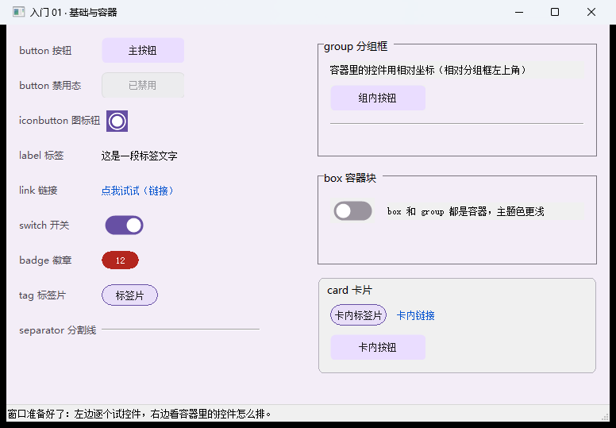

# 【CStackGUI 导读】用 C 写桌面小工具：界面用画布拖，改界面不用重编译

> 这是系列的第 1 篇（导读）。读完它你会知道：这套东西解决什么问题、适合谁、五分钟怎么跑起来第一个 exe、
> 以及后面六课各讲什么。完整示例在仓库 `examples\` 下，**每个示例都是一条命令编译、双击就能跑**。
>
> **配图**：本文配图已随稿放在 `docs\articles\images\00\` 下，Markdown 里直接显示；发到 CSDN 时上传这些文件即可。

---

## 一、它是什么（一句话 + 一张图）

> **界面用画布拖出来存成一个 `.cgui` 文件（JSON），运行时**读**它；业务逻辑写 C，只 include 一个头文件；
> 最后链成一个独立的 exe。**

三个概念，记住就够：

| 概念 | 是什么 | 谁维护 |
| --- | --- | --- |
| `.cgui` | 界面文件（JSON）：控件、位置、事件名、初始值 | 画布（或手改文本） |
| 运行时 | 解析 `.cgui`、创建原生控件、派发事件、自绘外观 | 框架（`runtime\`） |
| 业务 C | 你的回调：读值、写值、干活 | 你（`main.c`） |

> 
> 图 1：`examples\lessons\lessons` 跑起来的样子 —— 一屏 12 类控件，改界面不用重新编译。

**最实在的两条好处**：

1. **改界面不用重新编译** —— 挪按钮、改文案，改完 `.cgui` 直接重跑 exe；
2. **发人就是发一个 exe** + 旁边那个 `.cgui`，不用装运行库、不用装解释器。

---

## 二、为什么又来一个 GUI 方案

不是说别的不好，而是"给自己/给同事写个小工具"这个场景有它自己的取舍：

| 方案 | 写界面 | 交付给同事 | 备注 |
| --- | --- | --- | --- |
| MFC / WTL | 代码量最大 | 一个 exe ✅ | 改界面要重新编译 |
| Qt | 有 Designer，但从"拖完"到"跑"要一圈构建 | 要带 dll 或静态链（体积大） | 上手成本高 |
| Python + tkinter | 最好写 | 要装解释器/依赖 ❌ | 发人最麻烦 |
| Electron / 套网页 | 前端那一套很熟 | 体积大（100MB+） | 串口这类本地能力要绕 |
| **CStackGUI** | **画布拖** | **一个 exe + 一个 json** ✅ | 见下节"边界"，它也有明显不擅长的 |

**它盯的场景很具体**：一个人、一台 Windows、一个给自己或小团队用的小工具
（读串口、批量改文件、连设备看数据、写个小配置工具），**要能一个 exe 发出去**。

---

## 三、先看边界：它不适合什么

买之前先看"不提供什么"，能省掉很多返工：

- **外观是 Win32 原生控件打底**：按钮、开关、勾选、输入框、滑块、进度条、圆环走 GDI+ 自绘外观层
  （能吃圆角与配色）；列表框、树、表格、标签页等**系统控件不吃自定义外观**（Win32 固有限制）。
- **窗口尺寸固定，没有布局引擎**：绝对坐标、所见即所得，**拉伸窗口不会重排**。
  （也正因为如此，很多行为是"直给"的：拖分隔条只改两块、容器变窄子控件不会跟着缩 —— 后面第 4 篇专门讲。）
- **画布是单选**：没有多选、组合、对齐工具条（有网格吸附和邻近参考线）。
- **菜单是声明式的**：能读"点了哪一项"，但没有运行时增删菜单项的 API。
- **控件绑定只镜像"值 / 文字 / 勾选"三类语义**，不做格式换算（不能把 0~100 映射成 0~5、也不会自动加 `%`）；
  要格式化还是写回调。
- **网页浏览控件是实验性的**（走系统 WebBrowser 控件，IE 内核）。

如果你的需求是"复杂自适应布局 / 跨平台 / 华丽动效"，这套东西会让你难受 —— 换方案更省事。

---

## 四、装什么

| 需要 | 版本 | 什么时候需要 |
| --- | --- | --- |
| MinGW-w64 gcc | 8+（实测 16.2） | **编译 exe 时**。默认找 `C:\mingw64\bin`；`gcc --version` 能跑就行 |
| Node.js | 22.12+ / 24+ | **只在你想改画布本身、重新打包画布时** |

**只想用它写工具的话，只要一个 gcc。** 画布是现成的（仓库里已打包好 `designer\release\CStackGUI.exe`），
双击就能用。

---

## 五、五分钟：从零到第一个 exe

```bat
:: ① 编译（在仓库根）
build-app.bat lessons\\lessons

:: ② 跑（双击也行）
examples\lessons\lessons\lessons.exe

:: ③ 不开窗自检：把每个绑定的事件合成调一次，专门用来发现"事件名写错了"
examples\lessons\lessons\lessons.exe --selftest examples\lessons\lessons\lessons.cgui
```

③ 会给你一份体检报告，长这样：

```
-- 结果: 控件 30 个, 触发回调 10 次, 未登记 0 个, 事件不支持 0 个, 绑定出错 0 个 --
selftest OK
```

**最后两个 `0` 才是重点**：没有"名字对不上的回调"，也没有"给这个控件绑了它不支持的事件"。

产物就在示例自己的目录里，结构很简单：

```
examples\lessons\lessons\
  lessons.exe     <- 双击就能跑（界面文件就在旁边，不用安装）
  lessons.cgui    <- 界面：用画布打开改，改完不用重新编译
  main.c                  <- 业务：你要读、要改的就是这个文件
  lib\                    <- 运行时库副本
```

**试一下第 1 条好处**：用画布打开那个 `.cgui`（或者直接当文本改），把某个控件的 `"text"` 改掉，
**不用编译**，直接重跑 exe —— 界面就变了。

---

## 六、它提供什么

**控件 42 种**：按钮、图标钮、标签、链接、开关、输入框（单行/多行/**数值框**）、富文本、复选框、单选钮、
下拉框、列表框、标签页、树、表格、进度条、圆环、滑块、仪表盘、状态灯、评分、分页、徽章、标签片、
菜单栏、菜单按钮、工具栏、分组框、容器块、卡片、分割线、分隔条、图片、外形框、时钟、画板、颜色选择、
状态栏、终端（日志视图）、图表、网页浏览……

**事件按控件特性分配**：控件级有 `click` / `dblclick` / `change` / `submit` / `select` / `release` /
`expand` / `collapse` / `tick` / `check` / `spin` / `gotfocus` / `lostfocus`（另有 `button`/`edit` 的
控件级鼠标键盘全套）；窗口级那套（`ready` / `close` / `size` / `keydown` / `wheel`…）写在 `app.events` 里。
**事件是按控件特性分配的**：标签、进度条、状态栏一个事件都没有；只有树有展开/折叠。

**业务侧不用碰 Windows API**：`cstackgui.h` 里带了一套基础能力 —— 读写文件、INI 配置、路径处理、
文本编码转换（UTF-8 ↔ GBK）、剪贴板、用默认程序打开文件/网址、启动外部程序、读写注册表、写日志。

**串口与网口也在同一层**：`cg_serial_*`（枚举/打开/收发）、`cg_net_*`（TCP 客户端与服务端、
UDP 数据报）。串口与 TCP 由运行时在读线程里搬进环形缓冲，业务在时钟回调里取。

**能打包交付**：仓库里有打包脚本（画布 + 预编译运行时库 + 示例 + 编译脚本 + 使用者说明），
打包前会真编译真跑一遍示例自检。

---

## 七、正文讲什么（建议按顺序看）

| 篇 | 主题 | 一屏摆齐的控件 |
| --- | --- | --- |
| [01 基础与容器](01-基础与容器.md) | 能点的、能显示的、能装东西的 | 按钮、图标钮、标签、链接、开关、徽章、标签片、分组框、容器块、卡片、分割线、状态栏 |
| [02 输入与选择](02-输入与选择.md) | 一个表单要用的全部输入控件 | 输入框（单行/多行/数值框）、复选、单选、下拉、列表、富文本、日期、月历 |
| [03 数值与指示](03-数值与指示.md) | 把数字显示出来 | 滑块、进度条、圆环、仪表盘、状态灯、评分、分页（含"一行 C 都不用写"的控件绑定） |
| [04 数据与日志](04-数据与日志.md) | 组织、刷新、看得见 | 标签页、树、表格、终端、图表、分隔条、时钟 |
| [05 命令与图形](05-命令与图形.md) | 菜单、画板、媒体 | 菜单栏、工具栏、菜单按钮、画板、外形框、图片、取色器、网页 |
| [06 主窗口与窗口事件](06-主窗口与窗口事件.md) | 窗口自己也是"控件" | 窗口配置 `app.*`、26 种窗口事件、程序信息 `app.info` |
| [07 实战：记事本](07-实战-记事本.md) | 一个"组装好的"真实工具 | 菜单分发、脏标记、状态栏刷新、配置持久化、关闭前拦截 |

**学习顺序建议**：先把 01~06 都编译、运行、各改一处东西跑通（每篇 10 分钟）；
然后打开 `examples\gallery`（控件陈列室）当字典翻；
最后照着 06 的结构写自己的第一个工具：**用画布画界面 → 导出 C 骨架 → 填回调**。

---

## 八、参考资料在地图上的位置

| 想了解 | 看哪份 |
| --- | --- |
| 界面文件 `.cgui` 每个字段是什么意思 | `docs\CGUI-FORMAT.md` |
| 内部为什么这么设计、模块怎么分层 | `docs\ARCHITECTURE.md` |
| 自绘外观（Material 风格）怎么改 | `docs\M3-SKIN.md` |
| 串口 / 网口 TCP 与 UDP 怎么用 | `docs\COMM.md` |
| 逐课地图与每课详解 | `examples\教学使用说明.md` |
| 把工程交付给别人、打包发布 | `packaging\` |

> **对不上时信谁**（优先级从高到低）：`runtime\` 的代码与 `tests\` 的断言 → `docs\*.md` → 界面上的文字提示。
> 两条"真相所在"的位置记一下：`.cgui` 的**字段语义**在 `runtime\src\core\cg_doc.c`；
> **控件类型表**在 `runtime\src\core\cg_doc_kind.c`。

---

## 九、下一篇

[入门 01｜基础与容器](01-基础与容器.md)：12 类基础控件 + 三种容器，以及那条最容易搞混的
**"容器里的坐标是相对的"**。

> 系列导航（发布时补链接）：
> 本篇是第 1 篇（导读）｜ 下一篇：[入门 01 基础与容器](01-基础与容器.md)

---

## 附：配图清单

| 文中位置 | 上传这个文件 | 说明 |
| --- | --- | --- |
| 图 1 | `build\lesson01_new2.png` | 一个真实示例跑起来的样子（也可换成你自己最满意的那张） |
