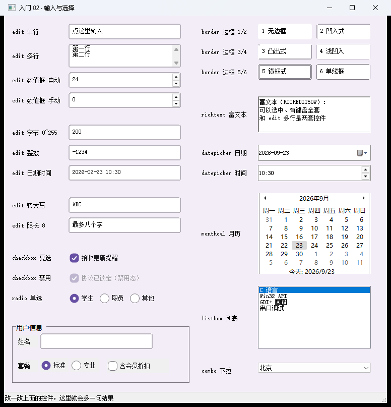
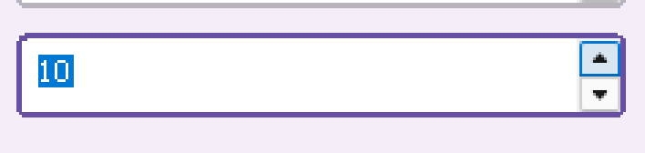
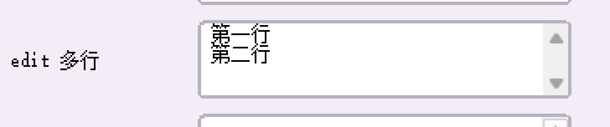
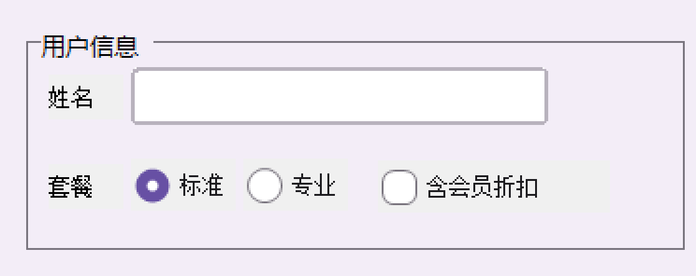

# 【CStackGUI 入门 02】输入与选择：一个表单要用的全部输入控件

> 本系列共 10 篇（导读 + 六课 + 实战 + 案例 + 校验与摘要），本篇是第 3 篇。
> 完整工程在 `examples\lessons\lesson02_inputs\`：**一条命令编译、双击就能跑**，本文所有文案与数字都取自它。
>
> **配图**：本文配图已随稿放在 `docs\articles\images\02\` 下，Markdown 里直接显示；发到 CSDN 时上传这些文件即可。

---

## 一、只要有输入，细节就多得吓人

做工具时，界面里最费心的往往不是"放个输入框"，而是这些琐碎问题：

- 这一栏只允许填数字（还要能填负数），用户敲了字母怎么办？
- 超出范围的输入，是当场挡掉、还是失焦时夹回、还是干脆清空？
- 多行输入回车怎么处理？行数多了滚动条会不会自己出来？
- 一栏最多 20 个字，粘贴进来 200 个怎么办？
- 三个"性别"单选钮，要不要写三个回调？

这一篇把这些问题**一次性**讲完 —— 而且你会发现，输入框的三种形态（单行 / 多行 /**数值框**）
在 `.cgui` 里**是同一个类型 `edit`**，只是字段不同。

> 
> 图 1：整窗。左列是输入框与选择类控件，右列是六种边框、富文本、日期月历、列表下拉，底部有一个容器表单。

---

## 二、跑起来 + 这一课的体检报告

```bat
build-app.bat lesson02_inputs
examples\lessons\lesson02_inputs\lesson02_inputs.exe
```

自检（不开窗，把每个绑定的事件合成调一次）：

```bat
examples\lessons\lesson02_inputs\lesson02_inputs.exe --selftest examples\lessons\lesson02_inputs\lesson02_inputs.cgui
-- 结果: 控件 55 个, 触发回调 29 次, 未登记 0 个, 事件不支持 0 个, 绑定出错 0 个 --
selftest OK
```

**55 个控件、29 个回调** —— 这一课控件多，是因为它把"一个表单要用的每一样"都摆了一份。

---

## 三、一屏总览

| 控件 | 类型 | 一句话 |
| --- | --- | --- |
| 输入框（单行） | `edit` | 文字一变就发 `change` |
| 输入框（多行） | `edit` + `multiline` | Enter 变换行，可带滚动条 |
| **数值框** | `edit` + `spin` | **`value` 是真相**，右侧带上下箭头 |
| 日期 / 时间 | `datepicker` | 原生控件，`format` 分 date / time / datetime |
| 月历 | `monthcal` | 点某天，日期写回 `text` |
| 富文本 | `richtext` | 能选中、有键盘全套；和 `edit` 多行是两套控件 |
| 复选框 | `checkbox` | 两态，读 `checked` |
| 单选钮 | `radio` | **同父兄弟之间互斥**，一组读"谁被选中" |
| 列表框 | `listbox` | 一组选项，读 `value` = 第几项 |
| 下拉框 | `combo` | 同上，收起时只占一行 |
| 分组框 | `group` | 容器，用来把一小组输入框框起来 |

---

## 四、输入框：三种形态，一个类型

### 4.1 单行：最普通的那个

```json
{ "id": "edt_single", "type": "edit",
  "rect": { "x": 128, "y": 16, "w": 224, "h": 32 },
  "text": "点这里输入",
  "hint": "单行输入框：文字一变就发 change",
  "events": { "change": "on_edt_single_change" } }
```

读和写都只有一对函数：

```c
const char *t = cg_widget_text(edt);        /* 借的，别 free */
char *keep = cg_str_dup(t);                  /* 要留着就拷一份：cg_str_dup（堆内存，用完 cg_free） */
cg_widget_set_text(edt, "改一段文字");       /* 程序改文本不会触发 change */
```

### 4.2 多行：加两个字段

```json
{ "id": "edt_multi", "type": "edit",
  "rect": { "x": 128, "y": 56, "w": 224, "h": 48 },
  "text": "第一行\n第二行",
  "multiline": true,
  "scroll": 2,
  "hint": "multiline: true + scroll: 2（2 = 纵向）；Enter 换行，行数多了右侧自己出滚动条" }
```

- `multiline: true` —— Enter 变成换行（而不是触发默认按钮）；
- `scroll` —— `1` 横向 / `2` 纵向 / `3` 双向（按位算，`3` = 横+纵）；
- **业务侧只管写 `\n`**：运行时在落到原生控件时会转成 Windows 要的 `\r\n`，你不用记这个差别。

### 4.3 数值框：`spin`，值是真相

这是最容易被忽略、但最省事的一种形态：**给它加上调节器，它就从"文本框"变成"数值控件"**。

```json
{ "id": "edt_spin_auto", "type": "edit",
  "rect": { "x": 128, "y": 112, "w": 224, "h": 32 },
  "value": 24, "min": 1, "max": 120, "spin": 1,
  "hint": "数值框：value 是真相（所以不写 text），点箭头运行时按 ±1 改值并夹到 1~120",
  "events": { "spin": "on_edt_spin_auto_spin" } }
```

**注意它没有 `text`** —— 因为界面上显示的数字是 `value` 派生出来的。于是它和滑块/进度条是同一套值语义：

```c
int v = cg_widget_value(edt);          /* 读值 */
cg_widget_set_value(edt, 42);          /* 写值，自动夹到 min/max；文本跟着更新 */
```

`spin` 的两档（都在这一课里）：

| 值 | 方式 | 行为 |
| --- | --- | --- |
| `1` | 自动 | 先派发 `spin`，再按 **±1** 改值并夹到 `min`~`max`；值真的变了还会**补派发一次 `change`** |
| `2` | 手动 | 只派发 `spin`，运行时**一个数都不改**，步长由你在回调里定 |

> **一次点箭头最多收到两个事件**：`spin: 1` 的顺序是"先 `spin`、后 `change`" ——
> 同一个回调若把这两个事件都绑上，别把同一次点击算两遍；只关心值就绑 `change`，只关心按钮就绑 `spin`。

手动那一档的用法（本课做成"步长 5"）：

```c
static void on_edt_spin_manual_spin(cg_widget_t *self, cg_event_t ev, void *user)
{
    int v = cg_widget_value(self) + cg_event_delta(self) * 5;   /* 自己的步长 */
    cg_widget_set_value(self, v);                              /* 写值；文本跟着派生 */
}
```

> 
> 图 2：点两下上箭头，值 0 → 10（每下 +5），状态栏同步报出。

**想让用户在"有范围的数字"里填，就用数值框，不要去 `atoi()` 文本** —— 前者自带过滤与夹取，
后者你要自己写一堆边界判断。

### 4.4 六个外观/行为字段，一次说清

| 字段 | 作用 | 取值 |
| --- | --- | --- |
| `multiline` | 允许多行 | `true` / 不写 |
| `scroll` | 滚动条 | `1` 横 / `2` 纵 / `3` 双向 / `0` 无 |
| `maxlen` | 最多几个字符 | 整数；`0` = 不限制 |
| `conv` | 大小写转换 | `1` 大写转小写 / `2` 小写转大写 |
| `border` | 边框样式 | `1` 无 / `2` 凹入 / `3` 凸出 / `4` 浅凹入 / `5` 镜框 / `6` 单线（不写 = 本工程自绘的圆角描边） |
| `input` | 输入方式 | 见下表 |

`input` 有 11 档，**这是本课最实用的一块**：

| 值 | 含义 | 值 | 含义 |
| --- | --- | --- | --- |
| `1` | 只读（能选中、改不了） | `7` | 整数（可为负） |
| `2` | 密码（显示成圆点） | `8` | 长整数 |
| `3` | 整数文本（只放行数字） | `9` | 小数 |
| `4` | 小数文本 | `10` | 双精度小数 |
| `5` | 字节 `0~255` | `11` | 日期时间 |
| `6` | 短整数 | `0` / 不写 | 通常方式 |

它背后的行为才是重点：**按键时只放行该类型可能出现的字符**（数字、负号、小数点、日期分隔符），
非法字符**连 `char` 事件都不会发**；**失焦时**能解析就夹到该类型范围并重写文本，解析不了就**清空**
（"没填"是合法状态，运行时不会弹窗骂人）。

```json
{ "id": "edt_byte", "type": "edit", "text": "200", "input": 5,
  "hint": "input: 5 = 字节。按键只放行数字，失焦时 0~255 之外夹回、非数字清空" }
```

> 
> 图 3：`multiline: true` + `scroll: 2` 的效果 —— 两行文字、右侧自带竖滚动条。

两个容易误解的地方：

- **`conv` 连"初始文本"一起转**：`text: "abc"` + `conv: 2` 进来就是 `ABC`（Windows 的
  `ES_UPPERCASE` 在写入时也转），不是"只转用户输入的"。
- **`maxlen` 是硬截断**：第 9 个字符敲不进去，**回调里也看不到** —— 别指望在 `change` 里自己再截一次。

---

## 五、选择类：复选、单选、下拉、列表、日期、月历

```json
{ "id": "chk_vip",    "type": "checkbox", "rect": { "x": 128, "y": 466, "w": 124, "h": 28 },
  "text": "接收更新提醒" }

{ "id": "rad_stu",    "type": "radio", "rect": { "x": 128, "y": 546, "w": 56, "h": 28 },
  "text": "学生", "checked": true }
{ "id": "rad_emp",    "type": "radio", "rect": { "x": 188, "y": 546, "w": 56, "h": 28 },
  "text": "职员" }
{ "id": "rad_other",  "type": "radio", "rect": { "x": 248, "y": 546, "w": 56, "h": 28 },
  "text": "其他" }
```

- **复选框**读 `checked`（`cg_widget_checked()`），不是读 `value`；
- **单选钮的互斥靠"同父兄弟"**：把它们放在同一个容器里就是一组。
  **程序改勾选不会自动取消兄弟** —— 你要自己写，或者干脆只读"谁是被选中的那个"；
- **列表框 / 下拉框**读 `value` = 第几项（`-1` = 没选），文字要再取一次：
  `cg_widget_list_item(cmb, idx)`；
- **日期 / 时间 / 月历**：日期框的 `format` 分 `date` / `time` / `datetime`
  （`datetime` 内部是两个原生控件的组合），月历点某天会把日期写回 `text`。

> **禁用态**：本课用 `checkbox` 演示（`enabled: false`）。
> 记住一条：**禁用控件照样能被读**，它只是点不动、也不发事件 ——
> 所以"协议已锁定"这种状态，读它的 `checked` 依然有效。

---

## 六、容器里的表单：坐标是相对的

```json
{ "id": "grp_user", "type": "group",
  "rect": { "x": 16, "y": 608, "w": 344, "h": 120 }, "text": "group 用户信息",
  "children": [
    { "id": "edt_grp_name", "type": "edit", "rect": { "x": 8, "y": 28, "w": 224, "h": 32 } },
    { "id": "rad_grp_a",    "type": "radio", "rect": { "x": 8,  "y": 76, "w": 56, "h": 28 }, "text": "标准" },
    { "id": "rad_grp_b",    "type": "radio", "rect": { "x": 68, "y": 76, "w": 56, "h": 28 }, "text": "专业" },
    { "id": "chk_grp_vip",  "type": "checkbox", "rect": { "x": 132, "y": 76, "w": 124, "h": 28 },
      "text": "含会员折扣" }
  ] }
```

`children` 里的 `rect` **相对容器左上角**。把整个 `group` 拖到别处，里面的控件跟着走。
另外注意：**这一组 radio 是另一组**（和上面那三个"学生/职员/其他"互不影响），因为它们的父容器不同。

> 
> 图 4：容器里的"姓名 + 标准/专业 + 含会员折扣"，整块挪动时不用改子坐标。

---

## 七、两种省代码的回调写法（本课的两个例外，要写清理由）

### 7.1 同组单选：一个回调就够

三个单选钮在业务上就是"一个选择"，没必要写三个几乎一样的函数：

```c
static void on_rad_group_change(cg_widget_t *self, cg_event_t ev, void *user)
{
    cg_app_t *app = cg_app_of(self);
    const char *who = cg_widget_checked(cg_find(app, "rad_stu")) ? "学生" :
                      cg_widget_checked(cg_find(app, "rad_emp")) ? "职员" : "其他";
    cg_status_setf(cg_find(app, "sb_main"), 0, "现在选中的是「%s」", who);
}
```

注意它是**读"整组现在的状态"**，不是读"谁被点的" —— 所以**点已选中的那个也会收到一次 `change`**，
回调不能假设"这次一定换了选择"。

### 7.2 多控件共用一个回调 + `cg_widget_id` 分流

六个边框输入框（外加容器里 4 个控件）共用一个 `on_form_change`，靠 `cg_widget_id(self)` 分流：

```c
static void on_form_change(cg_widget_t *self, cg_event_t ev, void *user)
{
    cg_app_t *app = cg_app_of(self);
    const char *id  = cg_widget_id(self);
    if (strcmp(id, "edt_b1") == 0) { /* … */ }
    /* … */
}
```

**省代码的写法，代价是 id 必须写清楚**（不能随便改 id，改了回调就分流错）。
除这两个例外，本课其余控件都是"一个控件一个专用回调"—— 文章里教这个度：**重复到第二遍就该合并**。

---

## 八、踩坑清单（本课全部踩过一遍）

1. **数值框不要写 `text`**（写了不生效）：显示的数字由 `value` 派生，写 `value`/`min`/`max`。
2. **`conv` 会连初始文本一起转**，别以为只影响用户输入。
3. **`input` 的过滤发生在按键层**：非法字符进不来，所以 `change` 里看到的永远是"合法中间态"；
   真正的范围校验在**失焦**那一刻。
4. **禁用控件仍可读**，只是点不动、不发事件（想演示禁用，用 `button`/`checkbox`/`radio`/`switch`
   这四类，皮肤真的画得出灰态）。
5. **同组单选共用一个回调**，且"点已选中项也会发 `change`"。

---

## 九、验收

```bat
examples\lessons\lesson02_inputs\lesson02_inputs.exe --selftest examples\lessons\lesson02_inputs\lesson02_inputs.cgui
:: 期望：控件 55 个, 触发回调 29 次, 未登记 0 个, 事件不支持 0 个, 绑定出错 0 个
```

---

## 十、下一篇

**入门 03｜数值与指示**：一个数怎么显示成一排指示器 —— 滑块、进度条、圆环、仪表盘、状态灯、
评分、分页；其中有一个**一行 C 都不用写**的控件绑定（`.cgui` 里填个 `bind` 就行），
还有一个大多数人都会问的问题：**点滑块轨道，为什么不是跳到我点的位置？**

> 系列导航（发布时补链接）：
> 上一篇：[入门 01 基础与容器](01-基础与容器.md) ｜ 下一篇：[入门 03 数值与指示](03-数值与指示.md)

---

## 附：配图清单

| 文中位置 | 上传这个文件 | 说明 |
| --- | --- | --- |
| 图 1 | `build\article02_full.png` | 整窗（左列输入框与选择类，右列边框/富文本/日期月历/列表下拉，底部容器表单） |
| 图 2 | `build\l02_tool_spin.png` | 数值框点两下上箭头：0 → 10（已放大 3 倍） |
| 图 3 | `docs\articles\images\02\图3-多行输入框.png` | `multiline: true` + `scroll: 2` 的效果（来源 `build\l02_multi.png`） |
| 图 4 | `docs\articles\images\02\图4-容器表单.png` | 容器表单那一块（`group 用户信息`） |
| 备选 | 需手动截一次 | 字节框里敲 `999` 再点别处被夹回 `255`（要真打字，工具代不了）：<br>`powershell -ExecutionPolicy Bypass -File tools\shot-widget.ps1 -Exe examples\lessons\lesson02_inputs\lesson02_inputs.exe -QX 128 -QY 216 -QW 224 -QH 32 -Out build\article02_byte.png` |

## 附：本例文件清单

```
examples\lessons\lesson02_inputs\
  lesson02_inputs.cgui   界面：11 类 / 55 个控件
  main.c                 业务：29 个回调（含两个"省代码"写法）
```
