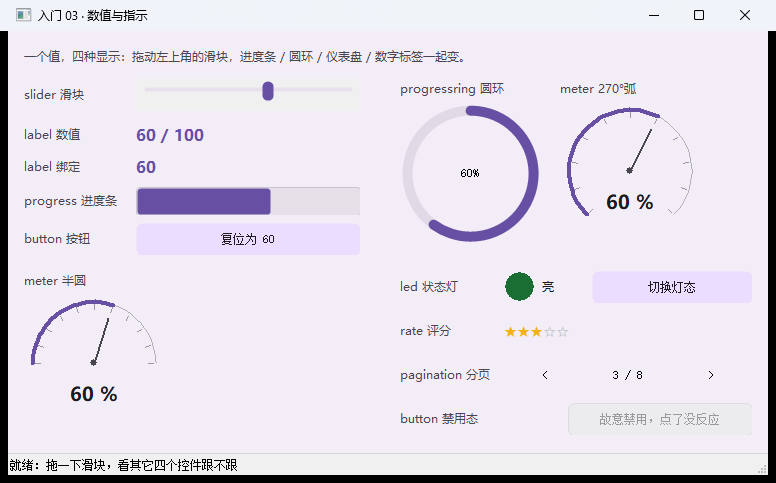
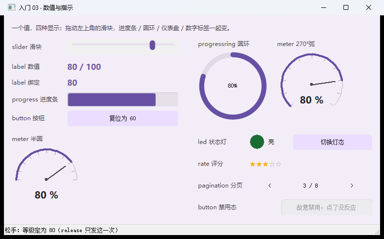
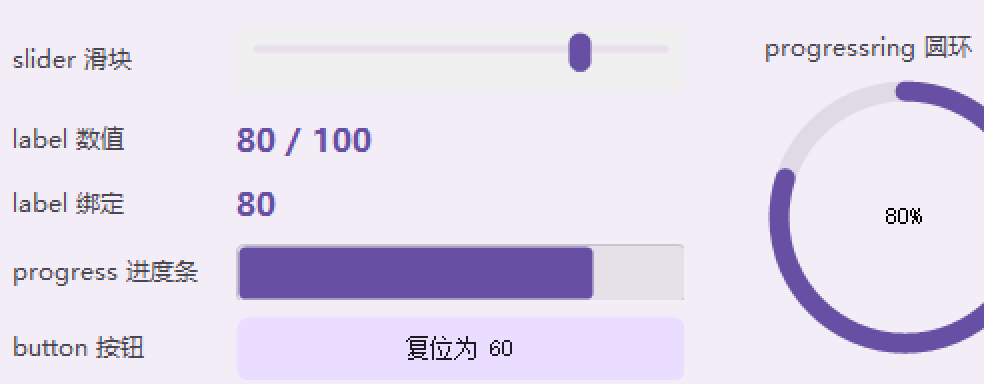

# 【CStackGUI 入门 03】数值与指示：一个数，七种显示方式

> 本系列共 5 篇（另有导读与实战篇），本篇是第 3 篇。
> 完整工程在 `examples\lesson03_values\`：**一条命令编译、双击就能跑**，本文所有文案与数字都取自它。
>
> **配图**：本文配图已随稿放在 `docs\articles\images\03\` 下，Markdown 里直接显示；发到 CSDN 时上传这些文件即可。

---

## 一、一个值，能有多少种"看得出来"

界面上凡是"0~100 之间的一个数"，都至少有七种画法：

- **进度条**：一眼看出"走到哪了"；
- **圆环**：省地方，适合放在角落里；
- **仪表盘**（270° 弧 / 半圆）：像仪表，读"当前水平"；
- **状态灯**：只有"正常/异常/闪烁"三种语义，比数字更快；
- **评分**：五颗星，比 `4.2` 直观；
- **分页**：数字 + 上下页，本质也是"当前位置"；
- **标签**：把数字本身显示出来。

这一课就用**一个滑块**驱动上面这一整排 —— 你会看到它们全都是"读一个 `value`"这么简单，
还顺带讲清两个每个人都会问的问题：**`change` 和 `release` 有什么区别**、**点滑块轨道为什么不是跳到我点的位置**。

> 
> 图 1：整窗。左列一个滑块 + 五种显示件；右列状态灯、评分、分页，以及两个对照标签。

---

## 二、跑起来 + 体检报告

```bat
build-app.bat lesson03_values
examples\lesson03_values\lesson03_values.exe

:: 自检（不开窗）
examples\lesson03_values\lesson03_values.exe --selftest examples\lesson03_values\lesson03_values.cgui
-- 结果: 控件 27 个, 触发回调 6 次, 未登记 0 个, 事件不支持 0 个, 绑定出错 0 个 --
selftest OK
```

**27 个控件只有 6 个回调** —— 这不是偷懒：显示类控件（进度条、圆环、仪表盘、状态灯、标签）
**一个事件都没有**，它们只被程序写。滑块的 `change` 一响，六个显示件一起刷新，就够了。

---

## 三、一屏总览

| 控件 | 类型 | 读 | 写 | 有事件吗 |
| --- | --- | --- | --- | --- |
| 滑块 | `slider` | `cg_widget_value()` | `cg_widget_set_value()` | ✅ `change` + `release` |
| 进度条 | `progress` | 同上 | 同上 | ❌ |
| 圆环 | `progressring` | 同上 | 同上 | ❌ |
| 仪表盘 | `meter` | 同上 | 同上 | ❌ |
| 状态灯 | `led` | 同上 | 同上 | ❌ |
| 评分 | `rate` | 同上 | 同上 | ✅ `change` |
| 分页 | `pagination` | 同上 | 同上 | ✅ `change` |
| 标签 | `label` | `cg_widget_text()` | `cg_widget_set_text()` | ❌ |
| 按钮 | `button` | — | — | ✅ `click` |

**共同点**：全部是"一个 `value`（+ `min`/`max`）"。会读写其中一个，其余七个用法一样。

---

## 四、滑块：`change` 与 `release`

```json
{ "id": "sld_level", "type": "slider",
  "rect": { "x": 128, "y": 56, "w": 224, "h": 32 },
  "value": 60, "min": 0, "max": 100,
  "hint": "拖动我：change 在拖动中连续发，release 只在松手时发一次",
  "events": { "change": "on_sld_level_change", "release": "on_sld_level_release" } }
```

| 事件 | 什么时候发 | 拿它干什么 |
| --- | --- | --- |
| `change` | **拖动过程中连续发**（值一变就发） | 实时刷新显示：进度条、圆环、标签 |
| `release` | **松手时发一次** | 做"贵"的事：写文件、发命令、记日志 |

本课的 `change` 就是"把六个数一起刷新"：

```c
static void on_sld_level_change(cg_widget_t *self, cg_event_t ev, void *user)
{
    cg_app_t *app = cg_app_of(self);
    int v = cg_widget_value(self);                       /* 读值 */
    cg_widget_set_value(cg_find(app, "prg_level"),  v);  /* 五个显示件都是一个写法 */
    cg_widget_set_value(cg_find(app, "ring_level"), v);
    cg_widget_set_value(cg_find(app, "mtr_arc"),    v);
    cg_widget_set_value(cg_find(app, "mtr_half"),   v);
    /* 数字标签要拼串，见第五节 */
}
```

### 两个必须知道的真实行为

**① 点轨道 ≠ 跳到你点的位置。** Windows 原生轨道的规矩是：在通道上点一下 = **朝那个方向走一格**
（本工程取量程的 1/10）。所以滑块在 60 时点最右端，只会走到 70（如果连点两下就是 80），不会直接跳 100。
**要精确设值请拖拇指。**

**② 命中带是"轨道那一条"，不是整个控件矩形。** 控件高 32px，但离轨道中心 16px 的地方点下去
是没有反应的（那不属于轨道）。做文章、写提示的时候别承诺"控件内点哪都行"。

> 
> 图 2：真点两下轨道右侧 → 60 变 80；进度条/圆环/两个仪表盘/两个标签同时跟上，状态栏报出 `release`。

### 程序改值不触发 `change`

点本课的「复位为 60」按钮，值会回到 60，但**`change` 回调不会响**：

```c
cg_widget_set_value(sld, 60);   /* 不发 change —— 否则回调会重入、连锁触发一串 */
```

所以按钮的回调里得自己把四个显示件刷一遍。这条规矩不只适用于滑块：**所有"程序写值"都不派发
`change`/`click` 这类事件**（钩子只代表"用户干了什么"）。

> 但有个例外要说清：**控件绑定（`bind`）会跟着走** —— 因为绑定是"同步"而不是"事件"。
> 见第五节那个 `lab_sld_mirror`。

---

## 五、控件绑定：一行 C 都不用写

先把两个标签并排放在滑块下面：

```json
{ "id": "lab_level",      "type": "label", "text": "60 / 100",
  "hint": "要显示成「60 / 100」这种拼出来的字符串，只能写 C" }

{ "id": "lab_sld_mirror", "type": "label", "text": "60",
  "hint": "这个标签没绑任何回调：它跟着滑块走，是 .cgui 里的 bind 实现的（见 CGUI-FORMAT 2.8）",
  "bind": { "src": "sld_level" } }
```

- `lab_sld_mirror` **没有 `events`，也不在 C 的绑定表里** —— 它的值一直跟着 `sld_level` 走，
  包括"程序改滑块值"和"用户拖动"两种情况；
- `lab_level` 要显示 `60 / 100` 这种**加工过的字符串**，只能走 C。

**一对比就明白边界在哪**：`bind` 只会**整份抄**（抄值 / 抄勾选 / 抄文字），
要拼串、要换算、要按条件改颜色，还是得写 C。抄什么由**目标控件类型**决定：

| 目标类型 | 抄什么 |
| --- | --- |
| 滑块、进度条、圆环、数值框、评分、分页、标签页、列表框、下拉框、工具栏 | 抄 `value`（列表类的下标**不按 min/max 夹**） |
| 复选框、单选钮、开关 | 抄勾选状态 |
| 标签、富文本、普通输入框、状态栏、按钮… | 源是文本型就抄文字，否则把数值写成十进制 |

> 还有一个有意思的点：**绑定的同步不触发目标的 `change`**。镜像是"跟着变"，不是用户操作 ——
> 所以你不会因为一个绑定，引来一串连锁回调。

> 
> 图 3：上面那个 `60 / 100` 是 C 写的，下面那个 `60` 一行 C 都没有，两个都跟着滑块走。

---

## 六、其余五种指示器

```json
{ "id": "prg_level",  "type": "progress",     "value": 60, "min": 0, "max": 100 }
{ "id": "ring_level", "type": "progressring", "value": 60, "min": 0, "max": 100 }
{ "id": "mtr_arc",    "type": "meter", "value": 60, "min": 0, "max": 100,
  "format": "arc",  "text": "%" }     /* format: arc = 270° 圆弧（缺省）/ half = 半圆 */
{ "id": "mtr_half",   "type": "meter", "value": 60, "min": 0, "max": 100,
  "format": "half", "text": "%" }     /* text 是画在中心数值下面的单位 */
```

**状态灯**用 `value` 表达三态，还能闪：

```json
{ "id": "led_state", "type": "led", "value": 1, "format": "round",
  "period": 500, "text": "亮" }
```

- `value`：`0` 灭 / `1` 亮（本课用同一个字段表达"闪"，点击按钮在状态间切）；
- `format`：`round`（圆）/ `square`（方）；
- `period`：闪烁周期（毫秒）——**只在"闪"这一态有意义**；
- `text`：灯右边的说明文字。

**评分与分页**同样只读一个 `value`：评分是"几颗星"（`max - min` = 星数），
分页是"第几页"（`max` = 总页数）。

```c
cg_widget_set_value(cg_find(app, "pg_page"), 2);   /* 跳到第 3 页（0 起） */
```

---

## 七、踩坑清单

1. **拖拽中别做重活**：`change` 会在拖动过程中连续触发（一秒几十次），
   写文件、发命令这类放到 `release`。
2. **程序写值不触发 `change`**：按钮/时钟里改了值，显示件要自己刷（绑定除外）。
3. **显示件没有事件**：`progress` / `progressring` / `meter` / `led` 挂不了回调 ——
   它们是输出，不是输入。要"点一下就改值"，用按钮或者换滑块。
4. **点轨道只走一格**，且命中带只有轨道那一条（见第四节）。
5. **演示禁用态要用 `button` / `checkbox` / `radio` / `switch`**：本课就用了按钮
   （`progress` 这类控件禁用前后长得一模一样，截图里分不出来）。
6. **`min`/`max` 不是装饰**：`cg_widget_set_value()` 会按它们夹取；
   但**列表类控件（标签页/列表框/下拉框/分页的下标）不走夹取**，跟用户点选是同一套语义。

---

## 八、验收

```bat
examples\lesson03_values\lesson03_values.exe --selftest examples\lesson03_values\lesson03_values.cgui
:: 期望：控件 27 个, 触发回调 6 次, 未登记 0 个, 事件不支持 0 个, 绑定出错 0 个
```

---

## 九、下一篇

**入门 04｜数据与日志**：装"一组数据"的控件 —— 标签页、树、表格、终端、图表；
还有一条被实测挖出来的规矩：**分隔条（`splitter`）天生是"两栏"语义**，
一个 pane 里塞多个控件，拖一下就会被裁掉半边。

> 系列导航（发布时补链接）：
> 上一篇：[入门 02 输入与选择](02-输入与选择.md) ｜ 下一篇：[入门 04 数据与日志](04-数据与日志.md)

---

## 附：配图清单

| 文中位置 | 上传这个文件 | 说明 |
| --- | --- | --- |
| 图 1 | `build\article03_full.png` | 整窗（滑块 + 五种显示件 + 状态灯/评分/分页 + 两个对照标签） |
| 图 2 | `build\l03_click_slider3_full.png` | 真点轨道后 80% 全联动（一张图同时证明 change 联动、bind 跟手、release 只发一次） |
| 图 3 | `build\l03_click_slider3.png` | 放大版：能同时看清 `80 / 100`（走 C 拼串）与 `80`（走 bind）两个标签 |

## 附：本例文件清单

```
examples\lesson03_values\
  lesson03_values.cgui   界面：10 类 / 27 个控件（含一个 bind 标签）
  main.c                 业务：6 个回调 + 一个"程序改值手动刷"的示范
```
