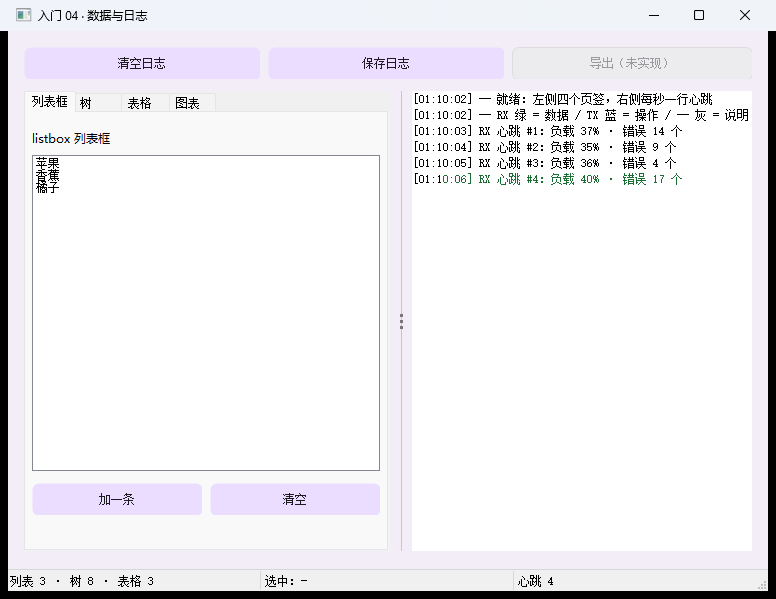
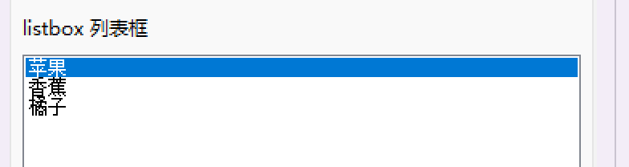
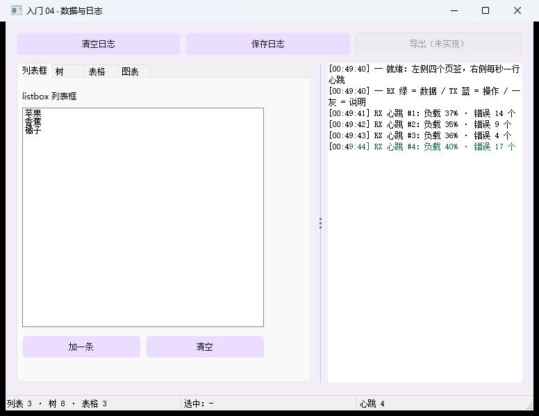

# 【CStackGUI 入门 04】数据与日志：树、表格、终端、图表，以及"分隔条只能分两栏"

> 本系列共 10 篇（导读 + 六课 + 实战 + 案例 + 校验与摘要），本篇是第 5 篇。
> 完整工程在 `examples\lessons\lesson04_data\`：**一条命令编译、双击就能跑**，本文所有文案与数字都取自它。
>
> **配图**：本文配图已随稿放在 `docs\articles\images\04\` 下，Markdown 里直接显示；发到 CSDN 时上传这些文件即可。

---

## 一、工具里的"数据"就这几种形状

写工具时，你要展示的数据基本逃不出这四类：

- **一列东西**：串口历史、文件列表、待办清单 → `listbox`
- **有层级的东西**：目录树、配置项、设备树 → `tree`
- **表格**：带列头、可能要勾选/多选的记录 → `table`
- **一直在刷新的东西**：日志、曲线 → `terminal` + `chart`

再外加两个"把这些装起来"的控件：**标签页**（省地方）和**分隔条**（让人自己调版面比例）。

这一课把这些一次摆齐，并且**在拖动与点击上踩出了两条真实行为**（第七节），它们比 API 本身更容易翻车。

> 
> 图 1：整窗。顶部动作行，左侧四页标签页（列表框/树/表格/图表），中间分隔条，右侧日志终端。

---

## 二、跑起来 + 体检报告

```bat
build-app.bat lesson04_data
examples\lessons\lesson04_data\lesson04_data.exe

:: 自检
examples\lessons\lesson04_data\lesson04_data.exe --selftest examples\lessons\lesson04_data\lesson04_data.cgui
-- 结果: 控件 23 个, 触发回调 18 次, 未登记 0 个, 事件不支持 0 个, 绑定出错 0 个 --
selftest OK
```

18 个回调看着多，其实是"每个按钮一个 + 每个控件一个"，都很短：改控件 → 写一行日志 → 刷状态栏。

---

## 三、一屏总览

| 控件 | 类型 | 干什么 |
| --- | --- | --- |
| 标签页 | `tabs` | 四页：列表框 / 树 / 表格 / 图表，当前页 = `value` |
| 列表框 | `listbox` | 一列条目，选中项 = `value` |
| 树 | `tree` | 层级节点，可展开/折叠 |
| 表格 | `table` | 列 + 行，支持多选与勾选列 |
| 终端 | `terminal` | 日志视图：按方向着色 + 时间戳 + 上限 + 存文件 |
| 图表 | `chart` | 折线 / 柱状，实时滚动 |
| 分隔条 | `splitter` | 拖动的分栏边界（**只能分两栏，见第七节**） |
| 时钟 | `timer` | 定时心跳，驱动图表与状态栏 |
| 状态栏 | `statusbar` | 分段显示汇总 |
| 按钮 / 标签 | `button` / `label` | 脚手架 |

---

## 四、三类数据控件：记住"五类 API"就不会找错函数

**加 / 清 / 数 / 读 / 选中** —— 这三类控件都是这五件事：

| 动作 | 列表框 | 树 | 表格 |
| --- | --- | --- | --- |
| 加 | `cg_widget_list_add` / `addf` | `cg_tree_add(w, parent, 文字)` | `cg_table_add_row(w, cells, n)` |
| 清 | `cg_widget_list_clear` | `cg_tree_clear` | `cg_table_clear` |
| 数 | `cg_widget_list_count` | `cg_tree_count` | `cg_table_row_count` |
| 读 | `cg_widget_list_item(w, i)` | `cg_tree_item_text(w, i)` | `cg_table_cell(w, r, c)` |
| 选中 | `cg_widget_value(w)` | `cg_tree_selected(w)` | 勾选：`cg_table_checked(w, r)` |

> 这几个读接口返回的字符串都是**借**的（控件内部缓冲），要留着就 `cg_str_dup(原串)` 拷一份
> （堆内存，用完 `cg_free`）；示例里凡是借堆的都还回去了。

### 4.1 列表框

```json
{ "id": "lst_items", "type": "listbox",
  "rect": { "x": 8, "y": 64, "w": 348, "h": 320 },
  "items": ["苹果", "香蕉", "橘子"], "value": -1,
  "hint": "cg_widget_list_add / clear / count / item；选中项 = cg_widget_value",
  "events": { "select": "on_lst_items_select" } }
```

`value: -1` = **一开始谁也不选**（不写就是 0，会默认选中第一条）。加一条：

```c
static int s_n = 0;
cg_widget_list_addf(lst, "条目 %d", ++s_n);   /* 带格式化，省一次 snprintf */
```

### 4.2 树

```json
{ "id": "tre_dir", "type": "tree",
  "nodes": [
    { "text": "项目", "children": [
        { "text": "runtime", "children": [{ "text": "core" }, { "text": "skin" }] },
        { "text": "examples" }, { "text": "docs" } ] },
    { "text": "构建产物", "children": [{ "text": "build" }] } ],
  "hint": "cg_tree_add(树, parent, 文字)；parent 传 -1 = 加在根上",
  "events": { "select": "on_tre_dir_select", "expand": "on_tre_dir_expand", "collapse": "on_tre_dir_collapse" } }
```

"加节点"按钮的做法（加在**当前选中节点**下面，没选中就加到根）：

```c
int parent = cg_tree_selected(tre);          /* -1 = 没选中 */
cg_tree_addf(tre, parent, "新节点 %d", ++n);
```

两个坑：

- **要在节点全部插完之后再 `cg_tree_expand()`** —— 插的过程中展开是空操作；
- 树是少数**有展开/折叠事件**的控件（`expand` / `collapse`），需要"懒加载子节点"时有用。

### 4.3 表格

```json
{ "id": "tbl_data", "type": "table",
  "columns": ["姓名", "城市", "状态"],
  "rows": [ ["张三", "北京", "在线"], ["李四", "上海", "离线"], ["王五", "广州", "在线"] ],
  "multi": true, "check": true,
  "hint": "cg_table_add_row / clear / row_count / cell(行,列)；勾选列 = cg_table_checked",
  "events": { "select": "on_tbl_data_select", "check": "on_tbl_data_check" } }
```

- `multi: true` 允许整行多选；`check: true` 显示**行首复选框列**；
- **勾选变化发的是 `check` 事件，不是 `select`**（这俩别混）；
- **行勾选状态、行附加数值、行图标都不是 `.cgui` 字段**，是运行时 API：
  `cg_table_set_checked()` / `cg_table_row_value()` / `cg_table_set_row_icon()`；
- **没有"改一项"的 API**（只有加/清/数/读）：要改内容只能**整表重建** ——
  把要留的复制出来、清空、再按需要加回去。示例里那个"加一行"就是这么写的。
- **要填很多行就用 `cg_table_begin_update()` / `cg_table_end_update()` 包住**：
  既然"加一行"就是一次整表重建，那"填 200 行"就是重建 200 次 —— 界面上是一片连续闪烁，
  而且越填越慢（翻页、刷新日志尤其明显）。包住之后中间只记脏、结束时重建一次，
  看着就是"一下换好"。两个调用要与填表在**同一个消息处理里成对**出现。

---

## 五、终端：日志该有的样子

```json
{ "id": "term_log", "type": "terminal",
  "rect": { "x": 404, "y": 60, "w": 340, "h": 460 },
  "value": 500 }
```

```c
cg_term_write(term, CG_TERM_RX,  "OK\r\n", -1);      /* 一行：方向 + 数据 + 长度（-1 = 自己算 strlen） */
cg_term_write(term, CG_TERM_TX,  "AT\r\n", -1);
cg_term_write(term, CG_TERM_SYS, "已连接", -1);
```

它替你处理掉了日志视图的四件麻烦事：

- **按方向着色**：`RX` 绿 / `TX` 蓝 / `SYS` 灰，行首自动加标记；
- **一次调用 = 一段数据**：里面带 `\r\n` 会自动切成多行（串口一次收到 `"OK\r\nERR"` 是常态），
  而且一次调用只刷新一次界面，可以放心在收数据的循环里逐段调用；
- **行数上限**：`value: 500` —— 超了从最老的丢（日志不能无限涨）；
- **可选中复制 + 存文件**：选中复制是日志最常被做的事；`cg_term_save(w, path)` 存成 UTF-8 + CRLF。

> 时间戳：示例里每行带 `[HH:MM:SS]`（由运行时按需加上）。
> 串口收发的原始字节如果想按 hex 看，`cg_term_set_hex()` 切换成十六进制模式。

> 
> 图 2：日志区：RX 绿、TX 蓝、SYS 灰，每行带时间戳。

---

## 六、图表：推点，不是赋值

```json
{ "id": "cht_line", "type": "chart",
  "rect": { "x": 8, "y": 64, "w": 348, "h": 180 },
  "items": ["负载"], "value": 40, "format": "line" }
{ "id": "cht_bar",  "type": "chart",
  "rect": { "x": 8, "y": 252, "w": 348, "h": 180 },
  "items": ["错误"], "value": 30, "format": "bar" }
```

```c
cg_chart_push(cht_line, 0, value);   /* 给第 0 个系列推一个点 */
```

**两个字段的含义容易看错**（本课专门在 `hint` 里标了）：

- `items` = **系列名**（可以有多个系列，用不同颜色画在同一条折线图里）；
- `value` = **窗口里保留多少个点**（不是"当前值"！），超过就滚动丢掉最老的。

所以"图表怎么动起来"的标准写法就是时钟：

```c
static void on_tmr_beat_tick(cg_widget_t *self, cg_event_t ev, void *user)
{
    cg_app_t *app = cg_app_of(self);
    cg_chart_push(cg_find(app, "cht_line"), 0, next_load());
    cg_chart_push(cg_find(app, "cht_bar"),  0, next_err());
}
```

---

## 七、分隔条：它只能分两栏（实测挖出来的）

这是本课最值得记住的一条，因为**写错了不会报错，只会"拖一下就不对劲"**。

`splitter` 拖动时的真实行为（读运行时代码 + 拖动实测确认）：

> **只改两块的尺寸**：分隔条**紧挨着的前一块**，以及**同一容器里的最后一块**（由它吃掉剩余空间）；
> **夹在中间的其他兄弟，只被"平移"**（位置变、尺寸不变）。

于是"一个 pane 里堆多个控件"的写法会这样翻车：

- 右列排成"图表 / 图表 / 按钮 / 日志"，把分隔条往右拖 → 前两块和按钮行被整体右移，
  **被窗口右边缘裁掉**（那个"导出"按钮只剩半个字），只有最后的日志收窄保住了右边界。

**正确姿势**：

1. **一个 pane 只放一个控件**。想在一个 pane 里放多个（图表 + 按钮 + 日志），
   **先用 `group` / `card` / `box` 包成一个容器**，再拿容器当 pane；
2. 两端之外不要再放兄弟，否则一拖就被裁；
3. 另一个实测出来的边界：**运行时没有布局引擎** —— 拖大的一侧会**留白**，
   拖小的一侧**不会让容器里的固定尺寸子控件跟着缩**（它们会溢出被裁）。
   所以"pane 里放一个能伸缩的控件（终端 / 表格 / 画板）"最省事。

> 
> 图 3：往右拖 60px —— 左边标签页变宽、日志变窄，中间的控件与顶部动作行纹丝不动、没有被裁。

> **顺带一条**：`statusbar` 也是参与布局的兄弟。**有分隔条的窗口，请把状态栏写在
> `widgets` 数组的前面**，否则它会成为"最后一块"，拖分隔条就去改状态栏的宽度了。

---

## 八、踩坑清单

1. **表格的行勾选/行数值/行图标不是字段**，是 API；勾选变化发 `check` 而不是 `select`。
2. **没有"改一项"的 API**，要改就整表重建（复制 → 清空 → 重加）。
3. **图表 `value` 是窗口点数**，不是当前值；推点用 `cg_chart_push`。
4. **树节点要插完再展开**；`cg_tree_selected()` 返回 `-1` 表示没选中。
5. **分隔条两栏语义**（第七节）；状态栏要写在数组前面。
6. **`listbox` / `combo` / `tabs` 的 `value` 按项数夹取**（`0`..项数-1），与 `min`/`max` 无关，
   它和"用户点选"是同一套语义。

---

## 九、验收

```bat
examples\lessons\lesson04_data\lesson04_data.exe --selftest examples\lessons\lesson04_data\lesson04_data.cgui
:: 期望：控件 23 个, 触发回调 18 次, 未登记 0 个, 事件不支持 0 个, 绑定出错 0 个
```

---

## 十、下一篇

**入门 05｜命令与图形**：同一个动作从**菜单栏、工具栏、菜单按钮**三处发起，最后只写一份实现；
再用画板（`canvas`）随手画图、用 `shape` 摆外形、用 `image` 放图、用 `browser` 打开
"程序自己写的本地网页"。

> 系列导航（发布时补链接）：
> 上一篇：[入门 03 数值与指示](03-数值与指示.md) ｜ 下一篇：[入门 05 命令与图形](05-命令与图形.md)

---

## 附：配图清单

| 文中位置 | 上传这个文件 | 说明 |
| --- | --- | --- |
| 图 1 | `build\article04_full.png` | 整窗（顶部动作行 + 四页标签页 + 分隔条 + 终端） |
| 图 2 | `build\click_lst.png` | 放大图：点中列表第 1 行 → 终端里多出一行蓝色 `TX`（日志着色与时间戳一眼可见） |
| 图 3 | `build\shot-drag-p60.png` | 拖动分隔条 +60px 后的样子（中间控件没被裁） |
| 备选 | `build\click_tab4_full.png` | 切到"图表"页的整窗图（两张图表都有数据，可放第六节） |

## 附：本例文件清单

```
examples\lessons\lesson04_data\
  lesson04_data.cgui   界面：11 类 / 23 个控件（四页标签页 + 分隔条 + 终端）
  main.c               业务：18 个回调（含"整表重建"与"图表推点"）
```
