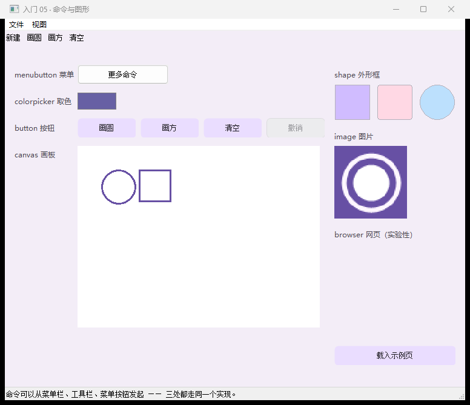

# 【CStackGUI 入门 05】命令与图形：三处入口，一份实现

> 本系列共 9 篇（导读 + 六课 + 实战 + 案例），本篇是第 6 篇。
> 完整工程在 `examples\lesson05_commands\`：**一条命令编译、双击就能跑**，本文所有文案与数字都取自它。
>
> **配图**：本文配图已随稿放在 `docs\articles\images\05\` 下，Markdown 里直接显示；发到 CSDN 时上传这些文件即可。

---

## 一、功能一多，最怕"同样的代码写三遍"

工具做大了自然会变成这样：

- **菜单栏**里有"新建 / 打开 / 保存"；
- **工具栏**上也有"新建 / 打开 / 保存"；
- 某个**菜单按钮**（长得像按钮的那种）里还有"新建"。

如果三处各写一遍实现，加一个功能就要改三个地方，改漏一处就是"菜单里能用、工具栏上不能用"的经典 bug。

这一课的做法很土但很有效：**定义一张命令表，三处入口最后都调同一个 `do_command()`**，
并且让状态栏写明"这次命令是从哪儿发起的"。后半篇再讲四个"图形类"控件：画板、取色、外形、图片，
外加一个实验性的网页控件。

> 
> 图 1：整窗。顶部菜单栏与工具栏，左侧画板（启动时就画好了两个图形），右侧外形框、图片与网页。

---

## 二、跑起来 + 体检报告

```bat
build-app.bat lesson05_commands
examples\lesson05_commands\lesson05_commands.exe

:: 自检
examples\lesson05_commands\lesson05_commands.exe --selftest examples\lesson05_commands\lesson05_commands.cgui
-- 结果: 控件 23 个, 触发回调 9 次, 未登记 0 个, 事件不支持 0 个, 绑定出错 0 个 --
selftest OK
```

---

## 三、一屏总览

| 控件 | 类型 | 干什么 |
| --- | --- | --- |
| 菜单栏 | `menu` | 顶部菜单，项写在 `nodes` |
| 工具栏 | `toolbar` | 一排文字按钮，点中第几项读 `value` |
| 菜单按钮 | `menubutton` | 长得像按钮的菜单，选中项用 `cg_menu_last_id` |
| 画板 | `canvas` | 用 `cg_canvas_*` 画图，绘制会被记录并回放 |
| 取色器 | `colorpicker` | 系统取色器，颜色存在 `value`（`0xRRGGBB`） |
| 外形框 | `shape` | 矩形 / 圆角 / 椭圆（`format`） |
| 图片 | `image` | 按原比例显示一张图（`src`） |
| 网页 | `browser` | 实验性：系统 WebBrowser 控件（IE 内核） |
| 按钮 | `button` | 命令的第四个入口（含一个禁用态示范） |

---

## 四、三处入口，一份实现

### 4.1 菜单栏：项要写 `id`

```json
{ "id": "menu_main", "type": "menu",
  "rect": { "x": 0, "y": 0, "w": 0, "h": 0 },
  "nodes": [
    { "text": "文件", "children": [
        { "text": "新建画板", "id": "m_new" },
        { "text": "载入示例页", "id": "m_page" } ] },
    { "text": "视图", "children": [
        { "text": "画圆", "id": "m_circle" },
        { "text": "画方", "id": "m_rect" },
        { "text": "-" },
        { "text": "清空", "id": "m_clear" } ] } ],
  "events": { "click": "on_menu_click" } }
```

- `nodes` 里每一项可以是子菜单（`children`），**`"-"` 就是一条分隔线**；
- 菜单栏没有矩形（`rect` 全 0）—— 它挂在窗口上，会把客户区往下挤，运行时自动处理；
- **点了哪一项，用 `cg_menu_last_id(self)` 认**：

```c
static void on_menu_click(cg_widget_t *self, cg_event_t ev, void *user)
{
    const char *id = cg_menu_last_id(self);        /* 就是 .cgui 里写的项 id */
    if (!id) return;
    if      (strcmp(id, "m_new") == 0)    do_command(cg_app_of(self), CMD_NEW,    "菜单");
    else if (strcmp(id, "m_circle") == 0) do_command(cg_app_of(self), CMD_CIRCLE, "菜单");
    /* … */
}
```

**项一定要写 `id`**：不写就只能拿 `cg_menu_last_text()` 按文字判断，等于把"文案"当成了"接口"，
改一次错别字逻辑就失效。

### 4.2 工具栏：读"点中第几项"

```json
{ "id": "tb_cmd", "type": "toolbar",
  "rect": { "x": 16, "y": 14, "w": 728, "h": 34 },
  "items": ["新建", "画圆", "画方", "清空"],
  "events": { "click": "on_tb_cmd_click" } }
```

```c
int idx = cg_widget_value(self);      /* 0 起、按 items 顺序；点空白处不发 click，值不变 */
switch (idx) {
case 0: do_command(cg_app_of(self), CMD_NEW,    "工具栏"); break;
case 1: do_command(cg_app_of(self), CMD_CIRCLE, "工具栏"); break;
/* … */
}
```

工具栏没有"项 id"这一说，**按 `items` 的顺序取下标**。顺序就是接口，所以 `items` 别随手重排。

### 4.3 菜单按钮：长得像按钮，行为是菜单

```json
{ "id": "mbtn_more", "type": "menubutton",
  "rect": { "x": 120, "y": 56, "w": 150, "h": 32 }, "text": "更多命令",
  "nodes": [
    { "text": "载入示例页", "id": "m_page" },
    { "text": "复制画板尺寸", "id": "m_size" } ],
  "events": { "click": "on_mbtn_more_click" } }
```

注意它的项 id 可以是**和菜单栏里同一个**（本例的 `m_page` 同时出现在菜单栏和菜单按钮里）——
因为它俩指的就是同一个命令。

### 4.4 命令表：本课的核心

```c
typedef enum {
    CMD_NEW, CMD_CIRCLE, CMD_RECT, CMD_CLEAR, CMD_PAGE, CMD_SIZE
} cmd_t;

static void do_command(cg_app_t *app, cmd_t cmd, const char *from)
{
    switch (cmd) {
    case CMD_CIRCLE: draw_circle(app, from); break;
    case CMD_CLEAR:  board_clear(app); say(app, "%s → 清空：画板和计数都归零", from); break;
    /* … */
    }
}
```

好处是**可以量化的**：

- **加一个命令只改这张表**，四个入口（菜单 / 工具栏 / 菜单按钮 / 按钮）都不用动；
- `from` 参数让状态栏能写明"这次是从哪儿点的"，调试与写文章时都比"看效果猜入口"快；
- **按钮也能直接调同一条命令**（本课的"画圆 / 画方 / 清空"就是这么接的），
  甚至程序自己也能调 —— 启动时先画两个图形，走的就是同一条路径。

> **动手验证**：从菜单、工具栏、按钮各点一次"画圆"，状态栏会分别报出 `菜单 → …`、`工具栏 → …`、
> `按钮 → …` —— 一眼就能看出三个入口最后都进了同一个 `do_command()`。

---

## 五、画板：`canvas`

```json
{ "id": "cv_board", "type": "canvas",
  "rect": { "x": 120, "y": 190, "w": 400, "h": 300 },
  "style": { "bg": "#FFFFFF" },
  "hint": "在画板里点一下 = 在点到的位置画一个小圆",
  "events": { "click": "on_cv_board_click" } }
```

```c
cg_canvas_set_color(cv, ink);            /* 颜色是 0xRRGGBB，影响**之后**画的图形 */
cg_canvas_set_line_width(cv, 3);
cg_canvas_ellipse(cv, x, y, 56, 56, 0);  /* fill=0 描边，1 实心 */
cg_canvas_rect(cv, x, y, 52, 52, 0);
cg_canvas_line(cv, x1, y1, x2, y2);
cg_canvas_clear(cv);                     /* 清掉"绘制记录"，重绘时不再回放 */
```

关键在最后一句的注释：

> **`cg_canvas_*` 画的图会被"记录下来"**，控件重绘（被盖住又露出来、改大小）时按顺序回放。
> 所以你不需要自己处理 `WM_PAINT`，但也意味着**图形是"重放"出来的，不是像素**：
> 想擦掉一个就得清空重画（或自己维护一个图形列表，每次全量重画 —— 这也是"撤销"的常规做法）。

**点一下画一个点**（本课最实用的 5 行）：

```c
static void on_cv_board_click(cg_widget_t *self, cg_event_t ev, void *user)
{
    int x = cg_event_x(self) - cg_widget_x(self);   /* 注意：要减掉控件自己的位置 */
    int y = cg_event_y(self) - cg_widget_y(self);
    cg_canvas_ellipse(self, x - 4, y - 4, 8, 8, 1);
}
```

**`cg_event_x/y()` 给的是"相对窗口客户区"的坐标**，而 `cg_canvas_*` 要的是"相对控件左上角"的坐标 ——
差的就是控件自己的位置，所以减一下就对了。这是做"取点工具 / 标注工具"的基础。

---

## 六、取色、外形、图片

### 6.1 `colorpicker`：颜色存在 `value`

```json
{ "id": "cp_ink", "type": "colorpicker",
  "rect": { "x": 120, "y": 102, "w": 64, "h": 28 },
  "value": 6774948,                       /* = 0x6750A4 */
  "events": { "change": "on_cp_ink_change" } }
```

```c
static void on_cp_ink_change(cg_widget_t *self, cg_event_t ev, void *user)
{
    s_ink = (unsigned)cg_widget_value(self) & 0xFFFFFFu;   /* 只读，别用 set_value 去写它 */
}
```

- `value` 是 `0xRRGGBB` 的十进制；
- **它是"非区间值"，用 `cg_widget_set_value()` 写会被 `min`/`max` 截断** —— 所以要程序改颜色，
  用专门的接口（或直接改 `.cgui` 初值）；
- 本例把它当"画笔颜色"：改颜色只影响**之后**画的图形（因为颜色是绘制时记下的）。

### 6.2 `shape`：三种外形，颜色走 `style.bg`

```json
{ "id": "sh_rect",   "type": "shape", "rect": { "x": 544, "y": 88, "w": 60, "h": 60 },
  "format": "rect",      "style": { "bg": "#D0BCFF" } }
{ "id": "sh_round",  "type": "shape", "format": "roundrect", "style": { "bg": "#FFD8E4" } }
{ "id": "sh_circle", "type": "shape", "format": "ellipse",   "style": { "bg": "#BCE0FD" } }
```

外形框是**纯显示件**（没有事件），常用来做色块、状态块、简单的图形示意。
`shape` 的 `bg` 是它唯一的"内容"，所以给 `style.bg` 是它的正常用法（不是"涂色装饰"）。

### 6.3 `image`：按原比例放图

```json
{ "id": "img_logo", "type": "image",
  "rect": { "x": 544, "y": 190, "w": 120, "h": 120 },
  "src": "assets/icon.png" }
```

`src` 是**相对 `.cgui` 文件**的路径（打包给别人时记得把 `assets\` 一起带上）。
换图不用重建控件：

```c
cg_widget_set_image(img, "assets/other.png");
```

---

## 七、`browser`：不用联网也能演示

```json
{ "id": "br_page", "type": "browser",
  "rect": { "x": 544, "y": 352, "w": 200, "h": 160 },
  "src": "about:blank" }
```

它是**实验性**控件（底层是系统自带的 WebBrowser 控件，IE 内核），最实用的用法是"显示程序自己生成的内容"：

```c
char *dir  = cg_app_data_dir();                       /* %LOCALAPPDATA%\<exe名>（会自动建） */
char *path = cg_path_join(dir, "demo.html");
if (cg_file_write(path, html) == 0) {                 /* 把 html 写到用户数据目录 */
    cg_browser_navigate(br, path);                    /* 再让浏览器控件打开这个本地文件 */
}
```

要点：

- **不需要联网**：写本地 html、打开本地路径就行（也可以指向 `https://`）；
- **空白不是坏了**：没载入内容时它就是白的 —— 所以界面上要给个按钮（本课的「载入示例页」）说明下一步；
- 它的内容由系统浏览器内核渲染：**配图前先确认截图工具拍得到内容**（若拍成空白，改用真实屏幕拷贝）。

---

## 八、踩坑清单

1. **菜单项要写 `id`**，不写就只能按文字判断；工具栏则按"顺序下标"取，`items` 别乱重排。
2. **画板的鼠标坐标要减掉控件自己的 x/y**（`cg_event_x/y` 是"相对窗口"的）。
3. **画板图形是"记录 + 回放"**：擦一个就得清空重画，或自己维护列表全量重画。
4. **取色器的 `value` 不能用 `cg_widget_set_value` 写**（会按 `min`/`max` 截断）。
5. **有副作用的命令在自检里要能跳过**：`--selftest` 会把回调全合成跑一遍，
   写文件、弹框、连设备这类动作先问一句 `if (!cg_app_has_window(app)) return;`
   （本课「载入示例页」就是这么处理的 —— 否则自检会凭空写出一个 html 文件）。
6. **禁用态**：本课的「撤销」按钮就是 `enabled: false`（禁用只有四类控件有视觉，见第 1 篇）。

---

## 九、验收

```bat
examples\lesson05_commands\lesson05_commands.exe --selftest examples\lesson05_commands\lesson05_commands.cgui
:: 期望：控件 23 个, 触发回调 9 次, 未登记 0 个, 事件不支持 0 个, 绑定出错 0 个
```

---

## 十、六课学完了，下一步

到这儿你已经把"界面 + 输入 + 显示 + 数据 + 命令"这五块都过了一遍，可以用它写一个真工具了。
后面的路：

- **想照着抄结构**：仓库里 `examples\notepad` 是一个完整的小工具 —— 菜单分发、脏标记、
  状态栏刷新、编码识别、配置持久化（记住上次打开的文件与窗口大小）、关闭前拦截，全套齐；
- **要接硬件**：`examples\serialterm`（串口）与 `examples\netterm`（TCP/UDP）是现成的模板，
  业务侧照样不用 include 任何 Windows 头文件；
- **想查某个控件还有哪些事件/字段**：`docs\CGUI-FORMAT.md`；
- **想一屏看全部控件**：`examples\gallery`（控件陈列室）。

> 系列导航（发布时补链接）：
> 上一篇：[入门 04 数据与日志](04-数据与日志.md) ｜ 下一篇：[入门 06 主窗口与窗口事件](06-主窗口与窗口事件.md)

---

## 附：配图清单

| 文中位置 | 上传这个文件 | 说明 |
| --- | --- | --- |
| 图 1 | `build\lesson05_final.png` | 整窗（菜单栏 + 工具栏 + 白底画板 + 外形/图片/网页 + 禁用按钮） |
| （可选） | 自截一次 | 依次从菜单、工具栏、按钮点"画圆"，对比状态栏里的 `菜单 → … / 工具栏 → … / 按钮 → …` |

## 附：本例文件清单

```
examples\lesson05_commands\
  lesson05_commands.cgui   界面：11 类 / 23 个控件
  main.c                   业务：命令表（6 条命令）+ 9 个回调
  assets\icon.png          图片控件用的图
```
