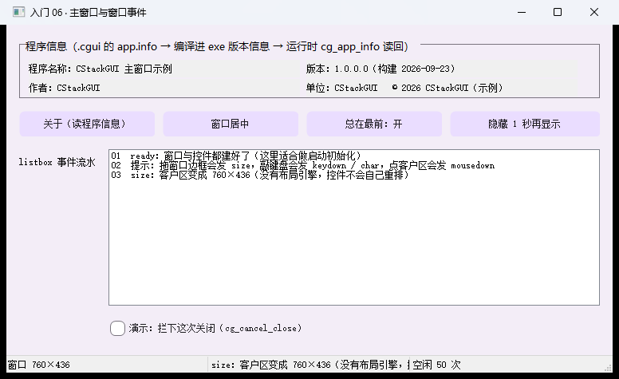
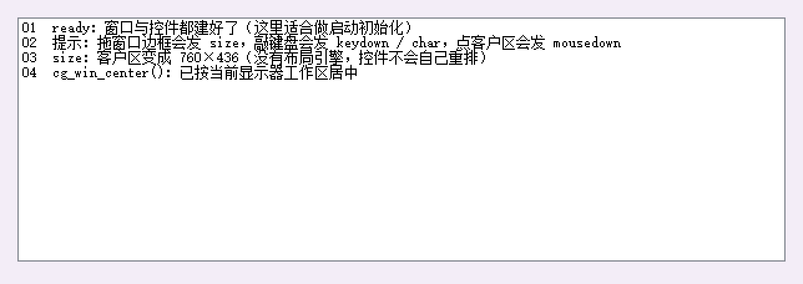

# 【CStackGUI 入门 06】主窗口与窗口事件：一页配置、26 种事件、程序信息

> 本系列共 10 篇（导读 + 六课 + 实战 + 案例 + 校验与摘要），本篇是第 7 篇。
> 完整工程在 `examples\lessons\lessons\`：**一条命令编译、双击就能跑**，本文所有文案与数字都取自它。
>
> **配图**：本文配图已随稿放在 `docs\articles\images\06\` 下，Markdown 里直接显示；发到 CSDN 时上传这些文件即可。

---

## 一、前五课讲控件，这一课讲窗口

前五课把"零件"都过了一遍：基础控件、输入、数值、数据、命令。但有个角色一直没正式出场 —— **窗口自己**。

它可不是"装控件的容器"这么简单：

- 它有一整套**配置**：标题、尺寸、底色、是否居中、边框样式（可调/固定/对话框/无边框）、
  总在最前、要不要在任务栏、Esc 关不关窗、有没有托盘图标、窗口图标、鼠标指针……
- 它有**自己的事件**：就绪、关闭、尺寸变化、按键、输入字符、鼠标、空闲、托盘、显示隐藏、拖放……**一共 26 个**；
- 它还有一份**程序信息**：产品名、版本、作者、单位、版权 —— 这份信息会被写进 exe 的**版本信息**里。

这一课把这三块一次讲清。核心结论先说：**窗口本身也是一个"控件"**（伪控件 id 固定是 `__window`），
它的配置写在 `.cgui` 的 `app` 里，事件写在 `app.events` 里，和控件事件共用同一套绑定机制。

> 
> 图 1：整窗。顶部"程序信息"全部由 `cg_app_info()` 从 exe 版本信息读回；中间是窗口事件流水；
> 下面一排窗口操作按钮 + 一个"演示拦下这次关闭"的勾选框。

---

## 二、跑起来 + 体检报告

```bat
build-app.bat lessons\\lessons
examples\lessons\lessons\lessons.exe

:: 自检
examples\lessons\lessons\lessons.exe --selftest examples\lessons\lessons\lessons.cgui
-- 结果: 控件 13 个, 触发回调 4 次, 未登记 0 个, 事件不支持 0 个, 绑定出错 0 个 --
selftest OK
```

**为什么 13 个控件只有 4 次回调？** 因为这 4 次全是按钮的 `click` ——
**`--selftest` 不开窗，所以窗口级事件（`ready`/`size`/`keydown`…）不会被合成触发**。
也就是说：**窗口事件只能真跑起来验**，这正是这一课的价值 —— 它跑起来之后自己就能证明自己：

> 日志第 1 行是 `ready`；第 3 行是 `size：客户区变成 760×436`（启动时窗口定尺寸就发了一次）；
> 状态栏第三格"空闲 N 次"说明 `idle` 正在跑。

---

## 三、窗口配置：一页 `.cgui` 就够

```json
"app": {
  "title": "入门 06 · 主窗口与窗口事件",
  "width": 760, "height": 436, "bg": "#F3EDF7",
  "center": true,
  "escClose": false,
  "tray": true,
  "events": { "ready": "on_app_ready", "close": "on_app_close", "…": "…" },
  "info": { "product": "…", "version": "…" }
}
```

`app` 里能配的全部字段（**不写的字段一律保持 Windows 默认行为**，所以老文件不受影响）：

| 字段 | 默认 | 说明 |
| --- | --- | --- |
| `x` / `y` | 系统决定 | 窗口左上角屏幕坐标（逻辑像素） |
| `center` | `false` | 启动时按当前显示器工作区居中（盖过 `x`/`y`） |
| `border` | `sizable` | `sizable` 可调整 / `fixed` 普通固定 / `dialog` 对话框固定 / `none` 无边框 |
| `controlBox` | `true` | 是否显示标题栏按钮组（系统菜单 + 关闭钮） |
| `minimizeBox` / `maximizeBox` | `true` | 是否显示最小化 / 最大化按钮 |
| `topmost` | `false` | 总在最前 |
| `taskbar` | `true` | 是否在任务栏显示 |
| `visible` | `true` | 启动即显示；`false` 时先隐藏，等业务 `cg_win_show()` |
| `enabled` | `true` | `false` = 整窗禁用（点了没反应） |
| `enterTab` | `false` | 回车当 Tab 下移焦点（默认回车触发 `submit`） |
| `escClose` | `true` | Esc 关窗；关掉后 Esc 会当成当前控件的 `submit` |
| `tray` | `false` | 建系统托盘图标（用窗口图标），并触发 `tray` 事件 |
| `icon` | 运行时自带 | 窗口图标 `.ico` 路径 |
| `cursor` | `arrow` | 窗口鼠标指针（hand / ibeam / wait / cross / sizeall … 共 13 种） |
| `class` | `CStackGUIMain` | 注册 Win32 窗口类用的名字，一般不用改 |

**这些都是"一行 C 都不用写"的部分** —— 想让窗口变成对话框样式、去掉最大化按钮、开机启动就居中，
改 `.cgui` 即可，**不用重新编译**。

---

## 四、程序信息：`app.info` 真的进 exe

```json
"info": {
  "product": "CStackGUI 主窗口示例",
  "desc": "入门 06：窗口配置、窗口事件、程序信息",
  "version": "1.0.0.0",
  "build": "2026-09-23",
  "author": "CStackGUI",
  "company": "CStackGUI",
  "copyright": "© 2026 CStackGUI（示例）",
  "email": "demo@example.com"
}
```

这份信息不是"给画布看的注释"，它有两条实在的用处：

1. **编译时会落进 exe 的版本信息**：把鼠标停在你编出来的 exe 上（右键 → 属性 → 详细信息），
   产品名、版本、作者、版权都在那儿 —— 发给别人时对方能一眼看清这是什么程序；
2. **运行时能用 C 读回来**：

```c
const char *name = cg_app_info(app, "product");   /* 键见 docs\CGUI-FORMAT.md 1.2 节，取不到返回 NULL */
```

本课顶部那一排就是这么填的（`ready` 回调里读一次，写进四个标签）。可读的键一共 14 个：
`product` / `desc` / `comments` / `version` / `build` / `author` / `company` / `copyright` /
`address` / `postcode` / `phone` / `fax` / `email` / `homepage`。

顺带一个实用小技巧：把 `cg_app_info` 拼起来就是"关于"框的内容 ——

```c
cg_message_box(self, text, "关于", 0);   /* 0 信息 / 1 警告 / 2 错误 / 3 问号 */
```

---

## 五、窗口事件：26 个，写在 `app.events` 里

```json
"app": {
  "events": {
    "ready":     "on_app_ready",
    "close":     "on_app_close",
    "size":      "on_win_size",
    "keydown":   "on_win_keydown",
    "char":      "on_win_char",
    "mousedown": "on_win_mousedown",
    "idle":      "on_app_idle",
    "tray":      "on_app_tray"
  }
}
```

**回调签名和控件事件完全一样**（`self` 就是窗口伪控件）：

```c
static void on_win_size(cg_widget_t *self, cg_event_t ev, void *user);
```

窗口支持的全部 26 个事件：

| 事件 | 什么时候发 | 参数怎么取 |
| --- | --- | --- |
| `ready` | 窗口与控件都建好、还没显示 | 启动初始化放这里 |
| `close` / `closequery` | 用户点关闭（或 Alt+F4） | 拦下来：`cg_cancel_close(app)` |
| `destroy` | 窗口已销毁、进程马上退出 | — |
| `move` / `size` | 位置 / **客户区尺寸**变了 | `cg_event_x` = 宽、`cg_event_y` = 高 |
| `activate` / `deactivate` / `firstactivate` | 被激活 / 取消激活 / 首次激活 | — |
| `idle` | 消息队列空着（**别在这里做耗时活**） | — |
| `tray` | 托盘图标被点 | `cg_tray_action()`：1 单击 / 2 双击 / 3 右键 |
| `show` / `hide` | 被显示 / 被隐藏 | — |
| `mousedown` / `mouseup` / `rdown` / `rup` / `mousemove` | 客户区鼠标动作 | `cg_event_x/y()` = **客户区坐标** |
| `dblclick` | 客户区双击 | 同上 |
| `gotfocus` / `lostfocus` | 窗口获得 / 失去键盘焦点 | — |
| `keydown` / `keyup` | 按下 / 放开按键 | `cg_event_key()` 虚拟键码、`cg_event_keys()` 功能键位或（1 Ctrl / 2 Shift / 4 Alt） |
| `char` | 输入了可打印字符（**中文输入法也走这里**） | `cg_event_key()` = 字符码 |
| `wheel` | 滚轮 | `cg_event_delta()`，正数向上 |
| `drop` | 有文件被拖进窗口 | `cg_drop_count()` / `cg_drop_file()` 取路径（给的是副本，用完 `cg_free`） |

本课演示了其中 8 个，每个都往"事件流水"列表写一行（列表用 `cg_widget_list_scroll_bottom()` 跟着滚）：

```c
static void on_win_keydown(cg_widget_t *self, cg_event_t ev, void *user)
{
    int vk = cg_event_key(self), keys = cg_event_keys(self);
    logev(cg_app_of(self), "keydown：键码 0x%02X%s%s%s", vk,
          (keys & 1) ? " +Ctrl" : "", (keys & 2) ? " +Shift" : "", (keys & 4) ? " +Alt" : "");
}
```

> 
> 图 2：运行起来后的流水 —— `ready`、`size`，以及点一下「窗口居中」按钮后新增的行。
> 拖窗口边框、敲键盘、点客户区、点托盘图标，都会继续往下加。

---

## 六、窗口级 API

| 想干什么 | 用哪个 |
| --- | --- |
| 居中 / 挪位置 / 改尺寸 | `cg_win_center(app)` / `cg_win_set_pos(app,x,y)` / `cg_win_set_size(app,w,h)` |
| 显示、隐藏 | `cg_win_show(app, 1/0)` |
| 置顶开关 | `cg_win_set_topmost(app, on)` |
| 最大化 / 最小化 / 还原 | `cg_win_set_state(app, "max"/"min"/"normal")` |
| 换窗口图标 | `cg_win_set_icon(app, "app.ico")` |
| 拦下关闭 | `cg_cancel_close(app)`（只在 `close`/`closequery` 里有效） |
| 读程序信息 | `cg_app_info(app, "product")` |
| 托盘动作 | `cg_tray_action(self)` |
| 延时/定时 | `cg_set_timer(app, delay_ms, fn, user)` —— **一次性的，周期性任务要自己重挂** |
| 有没有窗口（自检判断） | `cg_app_has_window(app)` |

本课的"隐藏 1 秒再显示"就是这两句：

```c
cg_win_show(app, 0);                          /* 隐藏，会触发 hide 事件 */
cg_set_timer(app, 1000, show_again, app);     /* 一秒后拉回来，触发 show 事件 */
```

---

## 七、踩坑清单（本课全部踩过一遍）

1. **`--selftest` 不合成窗口事件**。窗口配置写错了、事件名写错了，自检**不一定报** ——
   它只检查"名字是否登记""控件是否支持"。窗口级的东西**只能真跑起来看**。
2. **托盘事件要先开字段**。`app.events` 里写了 `"tray": "on_tray"`，但 `app` 里没写 `"tray": true`，
   托盘图标根本不会建，那个回调就是**死代码**（写这一课时我自己就漏了：运行时是
   `if (app->doc.tray) cg_tray_set(...)`，字段不开就没图标）。
3. **`idle` 里别做耗时活**。它触发极其频繁（消息队列一空就来），做重活会把界面拖死；
   长时间的后台活应该用 `cg_set_timer()` 定周期做。本课只数个数、每 50 次刷一下状态栏。
4. **`cg_set_timer()` 是一次性的**：到点触发后自己回收，**不会自动重挂**。
5. **弹框前先问 `cg_app_has_window(app)`**：`--selftest` 不开窗，消息框会把自检卡死（这条是全框架通用）。
6. **`size` 事件里别指望控件重排**：运行时没有布局引擎，窗口变了尺寸，控件还是原来的绝对坐标。
7. **`move` / `size` / `idle` / `mousemove` 都很频繁**：要在这里做的事尽量轻，
   或者做成"攒够 N 次才处理一次"。

---

## 八、验收

```bat
examples\lessons\lessons\lessons.exe --selftest examples\lessons\lessons\lessons.cgui
:: 期望：控件 13 个, 触发回调 4 次, 未登记 0 个, 事件不支持 0 个, 绑定出错 0 个
```

再加一条**手动验收**（自检做不到的部分）：跑起来后拖一下窗口边框、敲几个键、点一下客户区、
点一下「窗口居中」，看那张流水表是不是每一类都多了一行。

---

## 九、下一篇

**实战篇｜照着记事本写自己的工具**：前面六课是零件与配置，最后一篇看一个**组装好的真实工具**
（`examples\suites\text`）—— 只有 5 个回调，却把菜单分发、脏标记、状态栏刷新、文件读写与编码识别、
配置持久化、关闭前拦截全做齐了。

> 系列导航（发布时补链接）：
> 上一篇：[入门 05 命令与图形](05-命令与图形.md) ｜ 下一篇：[实战：照着记事本写自己的工具](07-实战-记事本.md)

---

## 附：配图清单

| 文中位置 | 上传这个文件 | 说明 |
| --- | --- | --- |
| 图 1 | `docs\articles\images\06\图1-整窗.png` | 整窗（程序信息 + 事件流水 + 窗口操作按钮） |
| 图 2 | `docs\articles\images\06\图2-事件流水.png` | 运行后的流水（含点「窗口居中」后新增的一行） |

## 附：本例文件清单

```
examples\lessons\lessons\
  lessons.cgui   界面：13 个控件 + 整套窗口配置（app.* / app.events / app.info）
  main.c                 业务：8 个窗口事件 + 4 个窗口操作按钮
```
