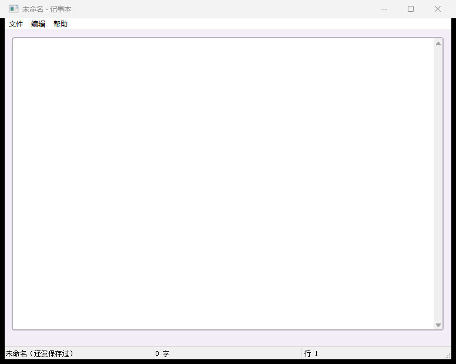

# 【CStackGUI 实战】照着记事本写自己的工具：菜单分发、脏标记、配置持久化

> 这是系列的第 8 篇（实战篇）。前面六课讲的是"零件"，这一篇看一个**组装好的真实工具**：
> 仓库里的 `examples\suites\text\`。
>
> **2026-10-18 注**：本文对应的工程已并入 [`examples\suites\${suite}\`](../../examples/suites/${suite})
> （本工具是其中一个页签，完整源码在 `modules\np.c`，整套编译 `build-app.bat suites\text`）。
> 文中的界面截图与自检数字取自合并前的独立运行；套件自检是整套口径（控件数更多），逐工具走读仍按本文。
>
> **配图**：本文配图已随稿放在 `docs\articles\images\07\` 下，Markdown 里直接显示；发到 CSDN 时上传这些文件即可。

---

## 一、为什么看这个示例

前六课每课只演示一个主题（基础控件 / 输入 / 数值 / 数据 / 命令 / 窗口），每个示例都刻意保持"一屏、一个主题"。
而真工具的样子是：

- 一屏里既有菜单、又有输入区、又有状态栏；
- 一个菜单项对应一段逻辑，但要共用同一套"改动 → 变脏 → 保存"的流程；
- 还要记住"上次打开的文件""上次的窗口大小"这种琐事；
- 用户点"关闭"时得先问一句"还没保存，真的要关吗？"。

`examples\suites\text` 就是把这些做完的**最小完整样本**：界面只有 3 个控件（菜单栏 + 一个多行输入框 + 状态栏），
C 侧只有 **8 个回调**（其中 3 个是"文件"菜单四条命令的动作回调）。

```bat
build-app.bat notepad
examples\suites\text\text.exe
```

> 
> 图 1：菜单栏（文件/编辑/帮助）+ 多行编辑区 + 三段状态栏（文件名 / 字数 / 行号）。

---

## 二、它的界面：20 行就能说清

```json
{
  "actions": {
    "new":     { "text": "新建",      "accel": "Ctrl+N",       "handler": "on_file_new" },
    "open":    { "text": "打开...",   "accel": "Ctrl+O",       "handler": "on_file_open" },
    "save":    { "text": "保存",      "accel": "Ctrl+S",       "handler": "on_file_save" },
    "save_as": { "text": "另存为...", "accel": "Ctrl+Shift+S", "handler": "on_file_save" }
  },

  "id": "menu_main", "type": "menu", "rect": { "x": 0, "y": 0, "w": 0, "h": 0 },
  "nodes": [
    { "text": "文件", "children": [
        { "action": "new" },
        { "action": "open" },
        { "action": "save" },
        { "action": "save_as" },
        { "text": "-" },
        { "text": "退出",     "id": "m_quit" } ] },
    { "text": "编辑", "children": [
        { "text": "复制全部", "id": "m_copy" },
        { "text": "粘贴",     "id": "m_paste" },
        { "text": "清空",     "id": "m_clear" } ] },
    { "text": "帮助", "children": [ { "text": "关于", "id": "m_about" } ] } ],
  "events": { "click": "on_menu_click" }
}

{ "id": "edt_body", "type": "edit",
  "rect": { "x": 12, "y": 12, "w": 736, "h": 500 },
  "multiline": true, "scroll": 2,
  "events": { "change": "on_body_change" } }

{ "id": "sb_main", "type": "statusbar",
  "rect": { "x": 0, "y": 536, "w": 760, "h": 24 },
  "items": ["未命名", "0 字", "行 1"] }
```

**注意三件事**：

1. **"文件"那四项不写文字、也不写 `id`**，只写 `"action": "new"` —— 文字、快捷键、回调名都在顶层
   `actions` 里写一次（这就是"动作"，见 4.1）；有动作的项点击**不再**走菜单控件的 click；
2. 其余 **5 个可点菜单项（另有一条 `"-"` 分隔线）只有 1 个回调**（`on_menu_click`）—— 项上的 `id` 就是"命令名"；
3. **状态栏预先分了三段** `["未命名", "0 字", "行 1"]` —— 后面用下标分别更新，
   比"每次自己拼一整行字符串"清楚得多（`cg_status_set(sb, 0, 文件名)`）。

---

## 三、C 侧只有 8 个回调（这才是重点）

```
on_ready         窗口就绪：读配置、恢复上次的文件与窗口尺寸
on_menu_click    菜单分发：剩下的 5 个可点菜单项的入口
on_file_new      动作 new：新建
on_file_open     动作 open：打开
on_file_save     动作 save / save_as：保存与另存为**共用一个函数**
on_body_change   内容变了：更新字数/行号 + 置脏标记
on_window_size   窗口尺寸变了：记下来（退出时写进配置）
on_close         关闭前拦截：脏了先问一句，用户确认才走
```

**真实工具的样子是"几个分发型回调 + 少量一人一职的动作回调"，不是几十个一对一的小函数。**
把这条记住，你后面写东西就不会陷入"每个菜单项都要一个函数"的泥坑。

> **什么时候用动作、什么时候用分发**：同一类命令很多、彼此只是参数不同（编辑菜单里的复制/粘贴/清空、
> 帮助里的关于）就用**一个分发函数 + `id`**；少数几条要配快捷键、或者要挂在多个地方上
> （"保存"这种：菜单里一项、将来工具栏可能再加一个、还得能按 Ctrl+S）就写成**动作** ——
> 一个回调管住所有入口，`cg_action_set_enabled()` 一处就能把它们一起变灰。
> 一根菜单里两种写法**可以混用**，这个示例就是混着的。

> **一个 API 细节**：`on_ready` 的签名和控件回调不一样 ——
> `static void on_ready(cg_app_t *app, void *user)`，第一个参数是 `cg_app_t *`；
> 因为它挂在 `desc.on_ready` 上（窗口级），而不是挂在 `.cgui` 的某个控件事件上。

---

## 四、五个"真工具必备件"

### 4.1 命令的两种写法：动作（actions）与菜单分发

「文件」菜单那四条命令在 `.cgui` 里写成**动作** —— 一条命令 = 文字 + 快捷键 + 一个回调名（`handler`）：

```json
"actions": { "save": { "text": "保存", "accel": "Ctrl+S", "handler": "on_file_save" } }
```

于是 `on_file_save` 就是"保存"这件事的**唯一入口**：菜单里那一项走它、以后工具栏再加一个按钮也走它、
Ctrl+S 也走它；`cg_action_set_enabled(app, "save", 0)` 一处就能把它们一起变灰。
**保存与另存为还共用一个函数**，靠 `cg_action_name(self)` 分辨是哪一条：

```c
static void on_file_save(cg_widget_t *self, cg_event_t ev, void *user)
{
    const char *name  = cg_action_name(self);        /* "save" 还是 "save_as" */
    int         force = (name && strcmp(name, "save_as") == 0);
    save_ask(cg_app_of(self), self, force);          /* force = 1 就强制弹路径对话框 */
}
```

> **动作回调的 `self` 不是菜单项**：它恒为主窗口伪控件（`cg_widget_id(self)` 是 `"__window"`）、
> `ev` 恒为 `click`。一个动作可能有好几个入口，"从哪个入口点的"不是业务该依赖的信息。
> 要拿别的控件就 `cg_find(cg_app_of(self), "edt_body")`；要弹对话框可以直接拿 `self` 当 parent。
>
> **快捷键为什么在输入框里也按得出来**：它走的是消息循环里的**加速键表**（`HACCEL`），
> 在按键到达控件之前就截住了。窗口级的 `keydown` 事件做不到这件事 —— 焦点在输入框里时
> 按键被输入框吃掉、不会冒泡到窗口。所以"保存/打开"这类命令都该写成动作。

剩下的命令（编辑 / 帮助 / 退出）仍然走**分发**：一个函数 + 项上的 `id`：

```c
static void on_menu_click(cg_widget_t *self, cg_event_t ev, void *user)
{
    cg_app_t   *app = cg_app_of(self);
    const char *id  = cg_menu_last_id(self);     /* 就是 .cgui 里写的项 id */
    if (!id) return;

    if (strcmp(id, "m_copy") == 0) {
        cg_widget_t *edt = cg_find(app, "edt_body");
        cg_clip_set_text(edt ? cg_widget_text(edt) : "");   /* 真实代码里这一段就这么两句 */
    }
    /* … 粘贴 / 清空 / 关于 / 退出 各自一个分支 … */
}
```

**要写 id**：不写就只能靠 `cg_menu_last_text()` 按文字判断，改一次文案逻辑就失效。
（有 `action` 的菜单项是例外：它的点击直接走动作回调，`id` 在那项上没有意义，所以示例里干脆不写。）

### 4.2 脏标记 + 状态栏：改动落到"看得见"的地方

内容一变就做三件事：更新状态栏、置脏、让标题带上 `*`（提示"还没保存"）。

```c
static void on_body_change(cg_widget_t *self, cg_event_t ev, void *user)
{
    /* ① 字数 / 行号：cg_widget_text() 拿全文本，数一数 */
    /* ② 置脏：s_dirty = 1（任何"能改变内容"的路径都要走到这里！） */
    /* ③ 状态栏第 1、2 段更新；标题加上/去掉 * */
}
```

**脏标记最容易写漏的地方**：不只是"用户打字"，还有"粘贴""清空""新建""打开失败"……
统一的做法是**所有改动都走同一个"设置内容"的函数**，在那个函数里置脏，而不是到处手写 `dirty = 1`。

### 4.3 打开 / 保存：对话框 + 读写 + 编码

```c
/* 打开：参数是（控件, 标题, "过滤器1|过滤器2|…", 结果缓冲, 缓冲长度） */
if (cg_open_file_dialog(self, "打开", "文本文件(*.txt)|*.txt|所有文件(*.*)|*.*",
                        path, sizeof(path))) {
    char *raw = cg_file_read(path);           /* 整个文件读成字符串（UTF-8） */
    /* 编码识别：GBK / UTF-8 判断（中文不乱码的关键，判断逻辑就在这个示例里） */
    cg_widget_set_text(edt_body, raw ? raw : "");
    /* 程序改文本不触发 change：状态栏、脏标记、标题都要自己刷一遍 */
    if (s_biz.cfg[0]) cg_ini_write(s_biz.cfg, "文件", "上次", path);   /* 记住上次打开的文件 */
}

/* 保存：多一个"默认扩展名"参数，其余同理 */
cg_save_file_dialog(self, "保存到", filter, "txt", path, sizeof(path));
```

三条经验：

1. **`cg_file_read()` / `cg_file_write()` 是"整个文件"级别的**（工具里读写小文本足够了）；
2. **写文件固定用 UTF-8**，读的时候才需要"识别"——识别逻辑就在这个示例里，值得抄；
3. **程序改文本不会触发 `change`**（这是框架的规矩：事件只代表"用户干了什么"）——
   所以"打开文件后"的状态栏、脏标记、标题都要自己刷一遍。**这条最容易漏。**

### 4.4 配置持久化：记住上次的文件与窗口大小

```c
/* 读：参数是（ini 路径, 节, 键, 取不到时的默认值）；传 NULL 就是"没有就没有" */
char *w    = cg_ini_read(s_biz.cfg, "窗口", "宽",   NULL);
char *last = cg_ini_read(s_biz.cfg, "文件", "上次", NULL);

/* 写：覆盖写 —— 退出时把"内存里记着"的窗口尺寸落盘 */
cg_ini_write(s_biz.cfg, "窗口", "宽", sw);
cg_ini_write(s_biz.cfg, "窗口", "高", sh);
```

放在哪写？这个示例的取舍值得抄：

- **窗口尺寸**：`on_window_size` 里只"记在内存"（因为会高频触发），**退出时**统一写一次；
- **上次文件**：打开/保存成功时写（低频、而且是"用户做完一件事"的瞬间）。

配置文件的路径用 `cg_app_data_dir()` 拼 —— 它在 `%LOCALAPPDATA%\<exe名>\` 下，
**又不会污染程序目录**，也不会因为 exe 被放在只读目录而写失败。

### 4.5 关闭前拦截：别让用户白干

```c
static void on_close(cg_widget_t *self, cg_event_t ev, void *user)
{
    cg_app_t *app = cg_app_of(self);
    if (!s_dirty) return;                        /* 没改就放行 */

    /* ① 自检时不开窗、不能弹框，先问一句 */
    if (!cg_app_has_window(app)) return;

    /* ② 弹框问一句，用户选"取消"就拦下这次关闭 */
    if (/* 用户点了取消 */) cg_cancel_close(app);
}
```

**`cg_app_has_window(app)` 这一句是必须的**：`--selftest` 会把回调全合成跑一遍，
那时没有窗口，弹框会卡住整个自检。**所有会弹框、写文件、连设备的回调，都要先做这个判断。**

### 4.6 剪贴板：两个函数就够

```c
cg_clip_set_text(cg_widget_text(edt_body));      /* 复制全部 */
const char *t = cg_clip_get_text();              /* 粘贴 */
```

---

## 五、抄它的时候，注意这几处

1. **"程序改内容"之后要手动刷新**：打开文件、清空、新建之后，状态栏/脏标记/标题都得自己刷
   （因为程序改文本不触发 `change`）。
2. **脏标记集中在"设置内容"的那一个函数里**，不要在各个回调里散点式地 `dirty = 1`。
3. **配置写入选低频时机**：窗口尺寸这种高频变化的，内存里记、退出时写。
4. **对话框、写文件、连设备之前先 `cg_app_has_window()`**，否则自检会卡住或在自检里产生垃圾文件。
5. **`--selftest` 是你的安全网**：每次改完 `.cgui` 的事件名或回调，跑一遍；
   "未登记 0 个 / 事件不支持 0 个"就是合格线。

---

## 六、把它改成你的工具

这个示例的骨架可以直接拿来改，改动量通常只有三处：

| 改哪里 | 怎么改 |
| --- | --- |
| 界面 | 用画布把 `edt_body` 换成你要的控件（列表框 / 表格 / 终端…），窗口尺寸与状态栏段数一起调 |
| 命令 | 菜单项文字与 `id` 改成你的功能（`m_export` / `m_connect`…），`on_menu_click` 里加分支；要配快捷键、要被多处引用的写成顶层 `actions`（见 4.1） |
| 业务 | 在分支里调你的 C 代码；界面的读写就两类：`cg_widget_text/set_text`、`cg_widget_value/set_value` |

**别忘的三件事**：`--selftest` 要过、状态栏要有反馈、有副作用的地方加 `cg_app_has_window()`。

---

## 七、系列到此结束

六课 + 导读 + 实战 + 案例 + 校验与摘要，一共 10 篇，覆盖了：

- **零件**：42 种控件怎么用、事件怎么接、值怎么读写（01~06）；
- **组装**：一个真工具怎么组织（本篇）；
- **能力**：文件/INI/编码/剪贴板/串口/网口都在同一个头文件里（`cstackgui.h`）。

接下来最省事的路径：**打开画布，画一个你自己的界面，导出 C 骨架，把回调填上。**
遇到不确定的字段和事件，查 `docs\CGUI-FORMAT.md`；想一屏翻控件长相，看 `examples\gallery`；
想接硬件，抄 `examples\suites\comm` 的 serialterm 页（串口，`modules\st.c`）或 netterm 页（TCP/UDP，`modules\nt.c`）。

> 系列导航（发布时补链接）：
> 上一篇：[入门 06 主窗口与窗口事件](06-主窗口与窗口事件.md) ｜ 本篇是系列最后一篇

---

## 附：配图清单

| 文中位置 | 上传这个文件 | 说明 |
| --- | --- | --- |
| 图 1 | `build\article06_full.png` | 记事本整窗（菜单栏 + 编辑区 + 三段状态栏） |
| 备选 | 自己截一次 | 改动内容后标题带 `*`、状态栏字数变化；点关闭时弹出的"未保存"提示框 |

## 附：本例文件清单

```
examples\suites\text\
  notepad.cgui   界面：菜单栏（9 个可点项 + 1 条分隔线）+ 多行输入框 + 三段状态栏
  main.c         业务：5 个回调 + 配置持久化 + 脏标记 + 关闭拦截
```
